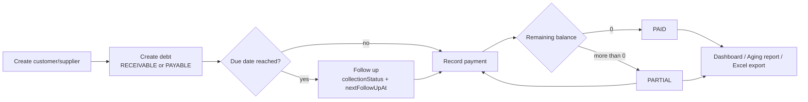

# 1. Product Overview

## What DebtFlow API is

DebtFlow API is the backend of **DebtFlow / Sales Debt Management**, a multi-tenant application that
helps a sales business track **who owes it money (receivables)** and **whom it owes money
(payables)**, record payments against those debts, and follow up on collection.

It is a standalone NestJS REST API. The web frontend ([debtflow-web](../../debtflow-web)) never calls
it directly from the browser: a Next.js BFF in `apps/shell` forwards requests server-side and attaches
the access token (see [Architecture](./02-architecture.md#how-the-frontend-talks-to-the-api)).

| Item           | Value                                                           |
| -------------- | --------------------------------------------------------------- |
| Framework      | NestJS 11 on Express 5                                          |
| Language       | TypeScript (strict)                                             |
| Database       | PostgreSQL (Neon) through Prisma 7 with the `pg` driver adapter |
| Auth           | JWT access + refresh tokens, organization role based access     |
| API docs       | OpenAPI 3 (Swagger UI at `/docs`, JSON at `/docs-json`)         |
| Hosting        | Vercel serverless (`api/index.js` -> `src/vercel.ts`)           |
| Base URL (dev) | `http://localhost:4000/api`                                     |

## Who uses it

| Persona        | Typical need                                                                                     |
| -------------- | ------------------------------------------------------------------------------------------------ |
| Owner / Admin  | Manage members, see everything, run all workflows.                                               |
| Accountant     | Create debts, record and reverse payments, maintain customers/suppliers.                         |
| Viewer         | Read-only access to parties, debts, payments, dashboard and reports.                             |
| Platform staff | `systemRole` PLATFORM_OWNER / PLATFORM_SUPPORT exist in the model but no endpoint uses them yet. |

Roles and the permission matrix are in [Business Rules](./03-business-rules.md#roles-and-permissions).

## Feature map

| Area                        | What it does                                                                                                                                   | Endpoints                                |
| --------------------------- | ---------------------------------------------------------------------------------------------------------------------------------------------- | ---------------------------------------- |
| **Authentication**          | Email + password login, refresh token exchange, switching the active organization, current-user profile.                                       | `/auth/*`                                |
| **Organizations & members** | Every user belongs to one or more organizations through memberships. List, edit and suspend members.                                           | `/users`, `/users/options`               |
| **Parties**                 | Customers, suppliers or both, with contact data, province, credit limit, assignee and outstanding balances.                                    | `/parties`                               |
| **Debts**                   | Receivable/payable documents with items, invoice/order/contract/PO references, due date and collection tracking.                               | `/debts`                                 |
| **Collection follow-up**    | Collection status (NEW, CONTACTED, PROMISED, DISPUTED, ESCALATED), next follow-up date, note and assignee.                                     | `PATCH /debts/{id}`, filters on `/debts` |
| **Payments**                | Pay one debt, or pay a party and auto-allocate across its oldest open debts; reverse a payment.                                                | `/debts/{id}/payments`, `/payments`      |
| **Catalog**                 | Categories, brands and products used by debt line items and filters.                                                                           | `/catalog/options`                       |
| **Dashboard**               | Totals, overdue count, action center (follow-ups and due soon), recent payments, nearest unsettled debts.                                      | `/dashboard`                             |
| **Reports**                 | Aging report in five buckets.                                                                                                                  | `/reports/aging`                         |
| **Export**                  | Excel (.xlsx) export of the filtered debt list.                                                                                                | `/exports/debts`                         |
| **Import**                  | Excel import of debts. **Scaffold only**: returns a placeholder message.                                                                       | `/imports/debts`                         |
| **Audit logs**              | Every change to debts, payments, parties and members is recorded (who, what, before/after) through domain events; read with `GET /audit-logs`. | `/audit-logs`                            |
| **Localization**            | Error and validation messages are localized (`vi`, `en`) through `src/common/i18n`.                                                            | all                                      |

The complete endpoint list with roles and parameters is generated in
[generated/api-reference.md](./generated/api-reference.md).

## Typical workflow

## Glossary

| Term              | Meaning                                                                        |
| ----------------- | ------------------------------------------------------------------------------ |
| Organization      | A tenant. All business data belongs to exactly one organization.               |
| Membership        | A user's role and status inside one organization.                              |
| Party             | A customer, supplier, or both (`PartyType`).                                   |
| Receivable        | `DebtType.RECEIVABLE`: a party owes the organization.                          |
| Payable           | `DebtType.PAYABLE`: the organization owes a party.                             |
| Debt              | One document to be settled. Remaining = `originalAmount - paidAmount`.         |
| Payment (voucher) | Money received or paid. May cover several debts through allocations.           |
| Allocation        | The part of a payment applied to a single debt (`PaymentAllocation`).          |
| Aging             | Grouping of unsettled debts by how many days past due they are.                |
| Collection status | Where a debt is in the follow-up process, independent from its payment status. |
| Envelope          | The standard JSON wrapper around every successful or failed response.          |
