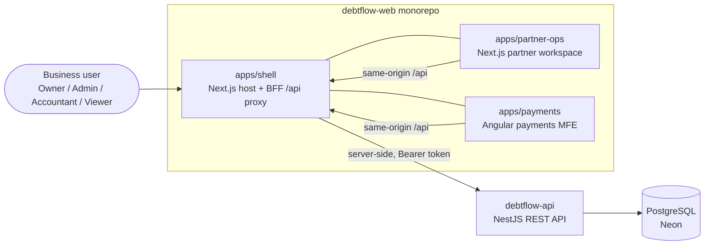
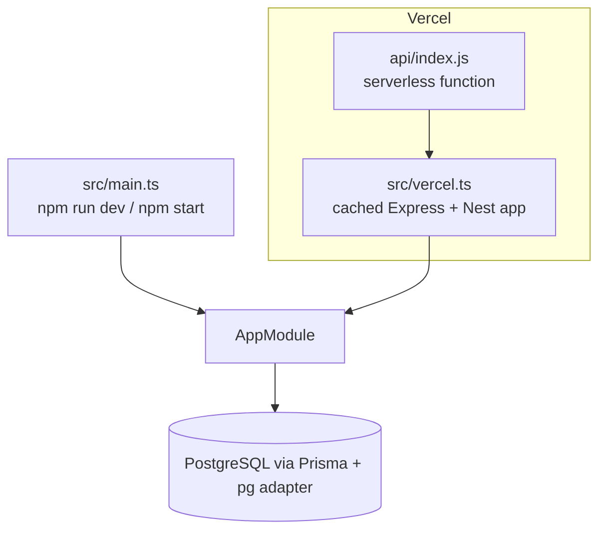
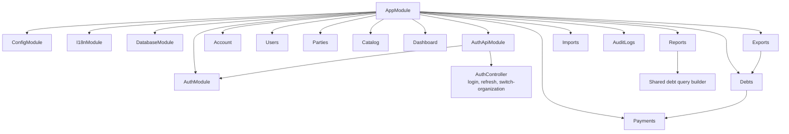
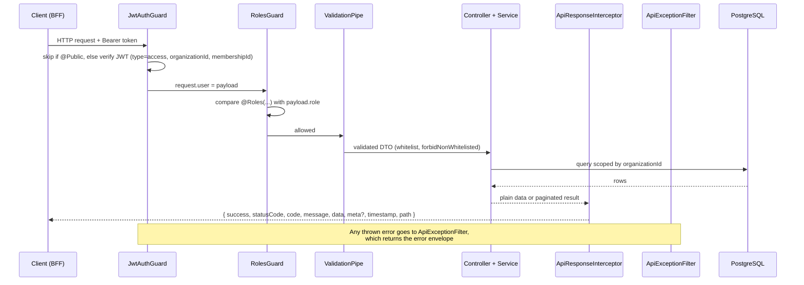

# 2. Architecture

## System context (C4 level 1)



The browser only talks to the shell's same-origin `/api/*` route. The BFF reads the access token from the
encrypted NextAuth session cookie and calls `API_BASE_URL` (`http://localhost:4000/api`) with
`Authorization: Bearer ...`. The backend URL is never exposed through a `NEXT_PUBLIC_*` variable.

## Containers and deployment (C4 level 2)



- **Local / server**: `src/main.ts` boots Nest and listens on `PORT` (default `4000`).
- **Vercel**: `src/vercel.ts` builds the Express app once per warm instance and reuses it.
- Both call `configureApp()` ([src/configure-app.ts](../src/configure-app.ts)), which sets the `/api` global
  prefix, CORS, the global `ValidationPipe` and the Swagger routes (`/docs`, `/docs-json`).
- Migrations are **not** part of the Vercel build. Run `npm run db:deploy` against production before
  promoting a release that contains a new migration.

## Module map (C4 level 3)



Modules are owned by **business domain**; public/protected access is declared on each route:

```text
src/
  main.ts, vercel.ts, app.module.ts, configure-app.ts
  auth/            JwtAuthGuard, RolesGuard, @Roles, @PublicApi, @ProtectedApi, @CurrentUser
  common/          envelope interceptor, exception filter, i18n, errors, events (audit), query (sort/filter), pagination, validation, utils
  config/          environment validation (DATABASE_URL, JWT_SECRET are required)
  database/        PrismaService (PrismaClient + pg adapter)
  generated/prisma Generated client (do not edit)
  modules/
    auth/          login/refresh (public), switch-organization (authenticated)
    account/, users/, parties/, catalog/, debts/, payments/
    dashboard/, reports/, exports/, imports/, audit-logs/
prisma/            schema.prisma, models/*.prisma, migrations/, seed.ts
scripts/           import-parties.ts, generate-api-docs.ts
docs/              this documentation
```

Inside a feature module, DTOs validate HTTP input and controllers bind context/policy before calling
services for business rules and persistence. Jobs and other adapters reuse the same owned services.
`AppModule` composes the HTTP application; reusable domain modules do not import it.

## Request lifecycle



Details of each step live in the guides: [request-flow](./guides/request-flow.md),
[validation-and-errors](./guides/validation-and-errors.md),
[api-response-format](./guides/api-response-format.md).

## Authentication and multi-tenancy

- A **User** is global; business data belongs to an **Organization**. A user reaches an organization
  through an **OrganizationMembership** (role + status).
- `POST /auth/login` verifies the password, picks an ACTIVE membership in an ACTIVE organization (the
  requested `organizationId`, otherwise the oldest membership) and signs two JWTs with `JWT_SECRET`:
  an access token (`JWT_EXPIRES_IN`, default 15m) and a refresh token (`JWT_REFRESH_EXPIRES_IN`, default 7d).
- The access token payload is `{ sub, email, systemRole, organizationId, membershipId, role, type: 'access' }`.
- Controllers pass `user.organizationId` into every service call and every query filters on it. This
  `organizationId` column on each business table is the **only** tenant isolation mechanism (no
  row-level security in PostgreSQL).
- `POST /auth/refresh` re-checks that the user and membership are still active, so suspending a member
  takes effect at the next refresh. The role inside an already-issued access token stays valid until it expires.
- `POST /auth/switch-organization` issues a new token pair for another organization the user belongs to.

## How the frontend talks to the API

| Concern         | Implementation (debtflow-web)                                                                                                                                                                        |
| --------------- | ---------------------------------------------------------------------------------------------------------------------------------------------------------------------------------------------------- |
| Proxy           | `apps/shell/src/app/api/[...path]/route.ts` forwards GET/POST/PATCH/PUT/DELETE to `API_BASE_URL`, adds the Bearer token and `Accept-Language`; 401 if no session, 503 if the backend is unreachable. |
| Session         | NextAuth with JWT sessions; access and refresh tokens live in the encrypted session cookie, not in local storage.                                                                                    |
| Login / refresh | `apps/shell/src/lib/auth/session.ts` calls `POST /auth/login` and `POST /auth/refresh` (refreshes 60 s before expiry).                                                                               |
| Browser client  | `apps/shell/src/lib/api/client.ts` unwraps the envelope, maps errors and field errors, handles timeouts.                                                                                             |
| Server client   | `apps/shell/src/lib/api/server.ts` calls the API directly from server components.                                                                                                                    |
| Shared types    | `packages/platform/contracts` holds the envelope and payment types. There is no generated OpenAPI client.                                                                                            |
| Other apps      | `apps/partner-ops` and `apps/payments` call same-origin `/api/*`, which the shell proxies.                                                                                                           |

Endpoints the frontend uses today: `/auth/login`, `/auth/refresh`, `/catalog/options`, `/dashboard`,
`/users`, `/users/options`, `/debts` (list, detail, create, update), `/parties` (list, detail, update),
`/debts/{id}/payments`, `/payments/auto-allocate`, `/payments` (list, delete), `/imports/debts`.
`/auth/me`, `/auth/switch-organization`, `/reports/aging`, `/exports/debts` and `/audit-logs` are not called by
the frontend yet.

## Cross-cutting conventions

| Topic         | Convention                                                                                                                                                                                                                                         |
| ------------- | -------------------------------------------------------------------------------------------------------------------------------------------------------------------------------------------------------------------------------------------------- |
| Response      | Global envelope; set `@SkipApiResponse()` for binary responses (Excel export).                                                                                                                                                                     |
| Pagination    | `page` (default 1) and `pageSize` (default 20, max 1000); result in `data` + `meta.pagination`.                                                                                                                                                    |
| Sort / filter | single-field `sortBy`+`sortOrder`, `filter[field][op]=value`, `filterOperator=AND\|OR` on every list endpoint, validated against a per-resource allow-list ([guide](./guides/list-query.md), modeled on [Vendure](./guides/vendure-reference.md)). |
| Validation    | Global `ValidationPipe`: `whitelist`, `forbidNonWhitelisted`, `transform`, stops at the first error.                                                                                                                                               |
| Money         | `Decimal(18,2)` in the database; amounts travel as numeric **strings** (`@IsNumberString`).                                                                                                                                                        |
| Dates         | ISO 8601 strings; dashboard period boundaries use the `+07:00` (Vietnam) offset.                                                                                                                                                                   |
| Imports       | TypeScript aliases rewritten at build time: `@auth`, `@common`, `@config`, `@database`, `@generated`, `@modules` ([guide](./guides/import-aliases.md)).                                                                                                                           |
| Localization  | `Accept-Language: en\|vi` (default `vi`) localizes `message` and validation errors; services throw translation keys, never text ([guide](./guides/localization.md)).                                                                               |
