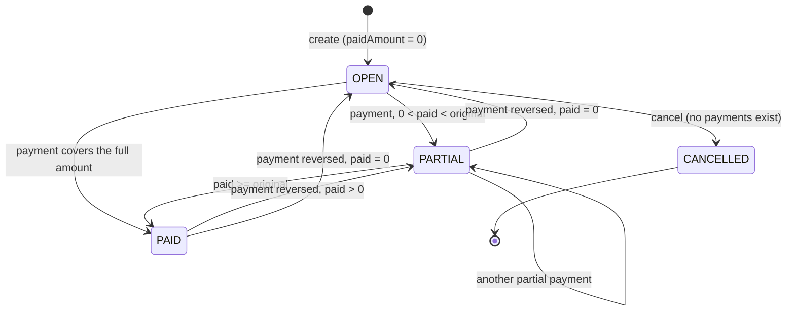
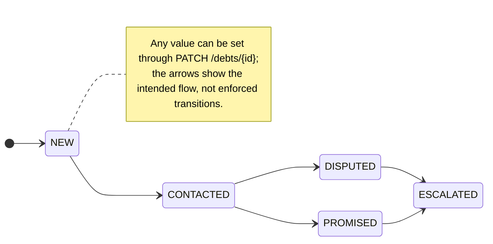
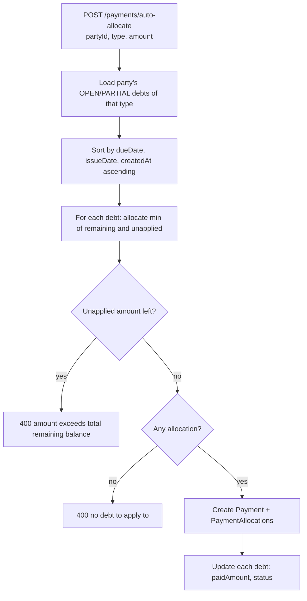

# 3. Business Rules

This page records the rules enforced by the code today. Each rule names the file that enforces it, so a
change in behaviour should be reflected here in the same pull request.

## Roles and permissions

Authorization is declared on controllers with `@Roles(...)` and enforced by `RolesGuard`
([src/auth/guards/roles.guard.ts](../src/auth/guards/roles.guard.ts)). The check is an **exact role match, not a hierarchy**:
a role not listed on an endpoint is rejected, even if it looks "higher" than the listed ones.
An endpoint without `@Roles` is open to every authenticated, active member.

| Capability                                        | OWNER | ADMIN | ACCOUNTANT | VIEWER |
| ------------------------------------------------- | :---: | :---: | :--------: | :----: |
| Read parties, debts, payments, dashboard, reports |  yes  |  yes  |    yes     |  yes   |
| Export debts to Excel                             |  yes  |  yes  |    yes     |  yes   |
| Create / update / deactivate parties              |  yes  |  yes  |    yes     |   no   |
| Create / update / cancel debts                    |  yes  |  yes  |    yes     |   no   |
| Record or reverse payments                        |  yes  |  yes  |    yes     |   no   |
| Update or suspend members                         |  yes  |  yes  |     no     |   no   |
| Run debt import (scaffold)                        |  no   |  yes  |    yes     |   no   |
| Read audit logs (own organization)                |  yes  |  yes  |     no     |   no   |

Note that `OWNER` is excluded from the import endpoint. This is the current behaviour of the
decorators, listed here so it is a conscious decision rather than a surprise.

## Debt lifecycle

`Debt.status` describes payment progress; `Debt.collectionStatus` describes follow-up. They are independent.

### Rules ([debts.service.ts](../src/modules/debts/services/debts.service.ts))

1. **Code**: generated per organization as `CN-YYYYMM-NNNN` (count of codes with the same month prefix + 1).
2. **Dates**: `dueDate` must not be earlier than `issueDate`.
3. **Items (optional)**: when `items` are sent, the sum of `lineAmount` must equal `originalAmount`.
   Product code, name, category and brand are copied onto the line so history survives catalog edits
   ([debt-line-item.service.ts](../src/modules/debts/services/debt-line-item.service.ts)).
4. **Editing**: `PATCH /debts/{id}` only changes collection data (assignee, collection status, follow-up
   date and note) and reference numbers/description. Omitted fields stay unchanged; explicit null clears
   nullable fields, but collection status cannot be null. Amount, dates, party and type cannot be edited after creation.
5. **Related resources**: creation requires an active party in the current organization. An assignee,
   when supplied on create or PATCH, must have an active membership and user in the active organization.
6. **Cancelling** (`DELETE /debts/{id}`) sets `status = CANCELLED`. It is rejected if the debt already has any payment allocation.
7. **Creator and tenant**: `createdById` is the token subject; `organizationId` always comes from the token, never from the body.

## Payments and allocation

A **Payment** is one voucher for one party and one direction (`type`: RECEIVABLE = money in, PAYABLE = money out).
It is split into **PaymentAllocation** rows, one per debt it settles
([payments.service.ts](../src/modules/payments/payments.service.ts)). Everything runs in a single database transaction.

| Rule                                              | Detail                                                                                                                                                                                                   |
| ------------------------------------------------- | -------------------------------------------------------------------------------------------------------------------------------------------------------------------------------------------------------- |
| Amount                                            | Must be greater than 0.                                                                                                                                                                                  |
| Single-debt payment (`POST /debts/{id}/payments`) | Rejected when the debt is `CANCELLED` or `PAID`, or when the amount exceeds `originalAmount - paidAmount`.                                                                                               |
| Auto allocation                                   | Oldest due date first. The whole amount must fit into the party's remaining balance, otherwise it is rejected (no overpayment or prepayment credit).                                                     |
| Debt update                                       | `paidAmount` is increased by the allocation; status becomes `PAID` when `paid >= original`, else `PARTIAL`.                                                                                              |
| Reversal (`DELETE /payments/{id}`)                | Deletes the payment (allocations cascade) and subtracts each allocation from its debt; status becomes `OPEN` at 0, `PARTIAL` otherwise, `PAID` if still fully paid. Returns `{ id, restoredDebtCount }`. |
| Method                                            | `CASH`, `BANK_TRANSFER` (default) or `OTHER`; optional `referenceNo` and `note`.                                                                                                                         |

## Parties

([parties.service.ts](../src/modules/parties/parties.service.ts))

- `type` is `CUSTOMER`, `SUPPLIER` or `BOTH`; `code` is optional but unique per organization.
- The list returns an outstanding **balance** per party: remaining receivable and remaining payable
  computed from `OPEN`/`PARTIAL` debts, and can be sorted by name or by number of outstanding documents.
- Search uses the normalized `searchText` column (see `src/common/utils/search-normalization.util.ts`).
- **Deactivate** is a soft delete (`isActive = false`) and is rejected while the party has any debt that is not `PAID` or `CANCELLED`.

## Collection follow-up and filtering

Every list endpoint also supports the generic `sort` and `filter[field][operator]` convention, see [List Query](./guides/list-query.md). The named filters below are the debt-specific shortcuts of `GET /debts` (see [api-reference](./generated/api-reference.md#get-apidebts)); `/reports/aging` and `/exports/debts` accept both kinds:

| Filter                                                                                                                                     | Values                                           | Meaning                                 |
| ------------------------------------------------------------------------------------------------------------------------------------------ | ------------------------------------------------ | --------------------------------------- |
| `aging`                                                                                                                                    | `not_due`, `1_7`, `8_30`, `31_60`, `60_plus`     | Unsettled debts by days past due.       |
| `followUp`                                                                                                                                 | `today`, `overdue`, `upcoming`                   | Compares `nextFollowUpAt` with today.   |
| `dueRange`                                                                                                                                 | `today`, `tomorrow`, `next_7_days`, `this_month` | Due date window.                        |
| `dueDate`, `dueDateFrom`, `dueDateTo`                                                                                                      | ISO date                                         | Exact day or custom window.             |
| `overdue`, `outstanding`                                                                                                                   | `true` / `false`                                 | Quick flags.                            |
| `type`, `status`, `collectionStatus`, `partyId`, `assignedToId`, `salesChannel`, `provinceCode`, `categoryId`, `brandId`, `productId`, `q` |                                                  | Straight field filters and text search. |

## Dashboard and reports

- **Dashboard** (`GET /dashboard`): original, paid and remaining totals per direction (cancelled debts excluded),
  overdue count, recent payments, the eight nearest unsettled debts, and an **action center**
  ([dashboard-action-center.service.ts](../src/modules/dashboard/services/dashboard-action-center.service.ts)) with
  collect/pay/follow-up queues and period trade totals. `dateFrom`/`dateTo` bound the period (business days use `+07:00`);
  `dateFrom` after `dateTo` is a 400.
- **Aging report** (`GET /reports/aging`): remaining balance and count across all matching OPEN/PARTIAL
  debts, aggregated in the database with the same tenant and debt filters as the list. It is not capped
  at 1000 rows. Pagination and sort parameters are accepted for compatibility but do not affect totals.
  Lists and reports share Vietnam calendar-day buckets: due today or later (`notDue`),
  1-7, 8-30, 31-60 and 61+ calendar days overdue. Yesterday is day 1; server timezone does not change
  the boundaries. A fixed report timestamp and a Repeatable Read transaction
  keep the five aggregate queries on one consistent database snapshot. Amounts are decimal strings.
- **Export** (`GET /exports/debts`): the same filters, up to 1000 rows, as an `.xlsx` file named `debtflow-debts.xlsx`.

## Audit trail

Services publish a domain event after each successful change and `AuditLogsListener` stores it as an
`AuditLog` row for the actor's organization ([ADR 0004](./adr/0004-audit-log-through-domain-events.md),
[guide](./guides/audit-log.md)). Recorded actions: `debt.created`, `debt.updated`, `debt.cancelled`,
`payment.created`, `payment.reversed`, `party.created`, `party.updated`, `party.deactivated`,
`member.created`, `member.updated`, `member.suspended`, `member.reactivated`. A failure to store an entry is logged and never fails the request.

## Members

([users.service.ts](../src/modules/users/services/users.service.ts))

- Members are listed through memberships of the current organization.
- `POST /users` creates a new global account and an ACTIVE membership in the current organization.
  Email and phone are globally unique. Passwords are hashed and limited to 72 UTF-8 bytes for bcrypt.
- `PATCH /users/{id}` updates name, phone and the member's role. Name and phone on a shared account
  can only be changed by the account holder; administrators may edit accounts belonging to one organization.
- Only OWNER and ADMIN can manage members; only OWNER can manage or grant OWNER access.
- Nobody can change their own role or suspend themselves.
- `DELETE /users/{id}` suspends the **membership** (`SUSPENDED`); it does not delete the user.
- `POST /users/{id}/reactivate` returns 200 and restores a SUSPENDED or INVITED membership to ACTIVE.
- Effective member status is ACTIVE only if both the account and membership are ACTIVE.
- Each protected request checks current access; suspension and role changes apply on the next request.
- There is no endpoint yet to invite an existing account or create an organization; seeds handle organization creation.

## Known gaps worth tracking

These are facts observed while writing this documentation, not planned work:

| Observation                                              | Where                   |
| -------------------------------------------------------- | ----------------------- |
| `POST /imports/debts` is a scaffold and imports nothing. | `imports.controller.ts` |
