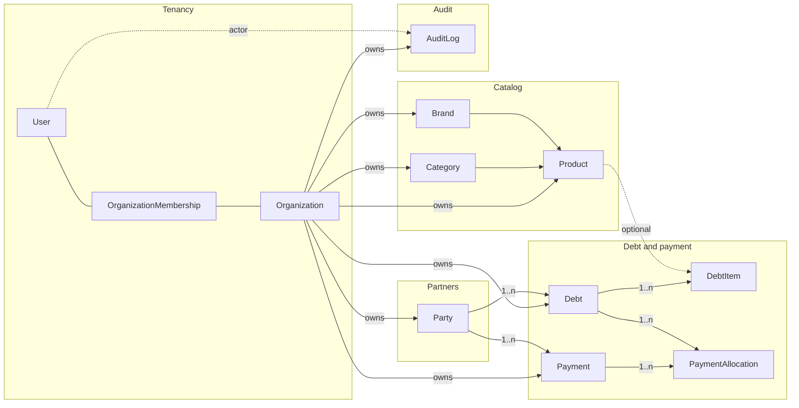
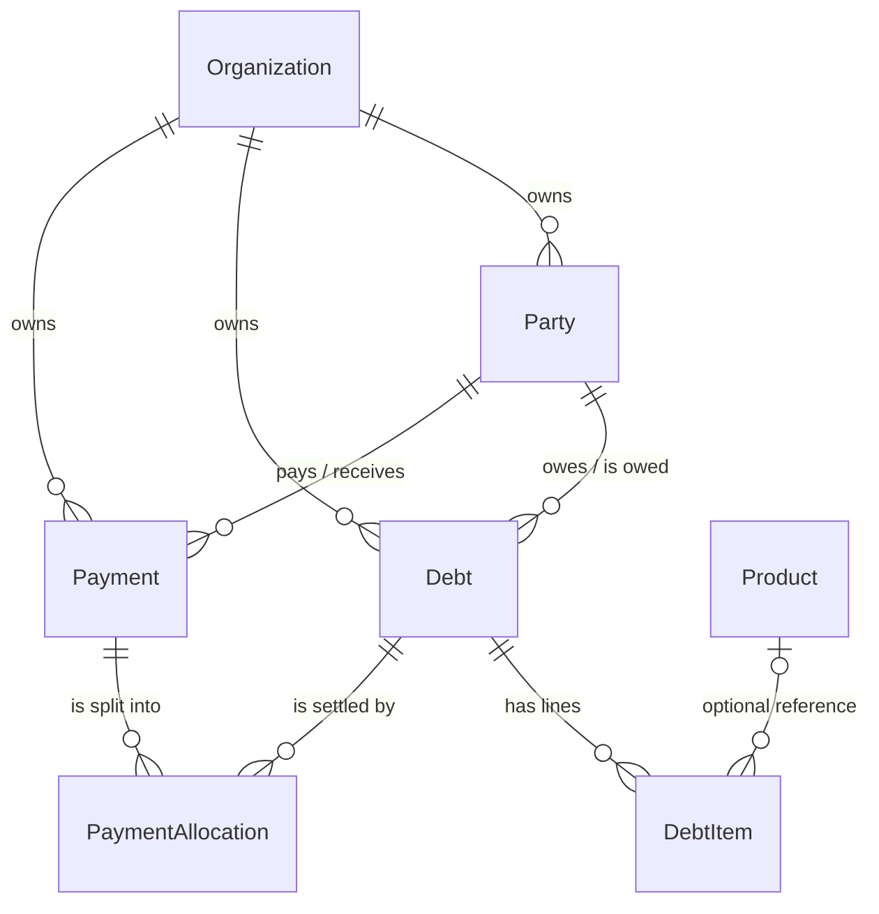

# 4. Database

The database is PostgreSQL, modelled with Prisma. Models are split by domain in
[`prisma/models/*.prisma`](../../prisma/models); [`prisma/schema.prisma`](../../prisma/schema.prisma) only holds the
generators and the datasource. Migrations are SQL files in [`prisma/migrations`](../../prisma/migrations).

> **Source of truth**: the `.prisma` files. The full ERD and the column dictionary are generated from them
> into [generated/database.md](../generated/database.md) by `npm run docs:generate:database`. This page is the hand-written
> guide to read that output.

## Domain overview

Domains and how they relate (tables are grouped; see the generated ERD for every column):

## Core entity relationships

The part that matters most to the business: a payment is applied to debts through allocations.

## Tables at a glance

| Model                          | Purpose                          |  Tenant column   | Notable constraints                                                                      |
| ------------------------------ | -------------------------------- | :--------------: | ---------------------------------------------------------------------------------------- |
| `User`                         | Login identity                   |        -         | `email` unique, `phone` unique                                                           |
| `Organization`                 | Tenant                           |        -         | `slug` unique                                                                            |
| `OrganizationMembership`       | User role inside an organization | `organizationId` | unique `(organizationId, userId)`                                                        |
| `Party`                        | Customer / supplier              | `organizationId` | unique `(organizationId, code)`; indexes on name and `searchText`                        |
| `Category`, `Brand`, `Product` | Catalog                          | `organizationId` | unique `(organizationId, code)`                                                          |
| `Debt`                         | Receivable / payable             | `organizationId` | unique `(organizationId, code)`; indexes on status, due date, follow-up, party, assignee |
| `DebtItem`                     | Debt line                        |   via `debtId`   | cascade delete with the debt                                                             |
| `Payment`                      | Voucher                          | `organizationId` | index `(organizationId, partyId, type, paidAt)`                                          |
| `PaymentAllocation`            | Payment-to-debt split            | via `paymentId`  | unique `(paymentId, debtId)`                                                             |
| `AuditLog`                     | Change history                   | `organizationId` | index `(organizationId, entityType, entityId)`                                           |

## Enums

| Enum                           | Values                                                  |
| ------------------------------ | ------------------------------------------------------- |
| `SystemRole`                   | `USER`, `PLATFORM_OWNER`, `PLATFORM_SUPPORT`            |
| `UserStatus`                   | `ACTIVE`, `INACTIVE`                                    |
| `OrganizationKind`             | `PERSONAL`, `BUSINESS`                                  |
| `OrganizationStatus`           | `PENDING`, `ACTIVE`, `SUSPENDED`, `CLOSED`              |
| `OrganizationRole`             | `OWNER`, `ADMIN`, `ACCOUNTANT`, `VIEWER`                |
| `OrganizationMembershipStatus` | `INVITED`, `ACTIVE`, `SUSPENDED`                        |
| `PartyType`                    | `CUSTOMER`, `SUPPLIER`, `BOTH`                          |
| `DebtType`                     | `RECEIVABLE`, `PAYABLE`                                 |
| `DebtStatus`                   | `OPEN`, `PARTIAL`, `PAID`, `CANCELLED`                  |
| `CollectionStatus`             | `NEW`, `CONTACTED`, `PROMISED`, `DISPUTED`, `ESCALATED` |
| `SalesChannel`                 | `STORE`, `ONLINE`, `WHOLESALE`                          |
| `PaymentMethod`                | `CASH`, `BANK_TRANSFER`, `OTHER`                        |

## Conventions

- **IDs** are `cuid()` strings.
- **Money** is `Decimal(18,2)`; quantities are `Decimal(14,3)`. Never convert money to JavaScript `number`;
  use `Prisma.Decimal` in services and strings in the API.
- **Tenancy**: every business table has `organizationId` with `onDelete: Restrict`, and every service query
  filters on it. New business tables must follow the same rule ([ADR 0001](../adr/0001-tenant-isolation-by-organization-id.md)).
- **Deletes**: parties, products and members are deactivated (`isActive` / membership `SUSPENDED`), not deleted.
  `Debt`, `Party` and `Payment` use `Restrict` toward their parents so history is never orphaned;
  `DebtItem`, `PaymentAllocation` and `OrganizationMembership` cascade with their parent.
- **Snapshots**: `DebtItem` copies product and category names so old debts do not change when the catalog changes.
- **Timestamps**: `createdAt` / `updatedAt` (`@updatedAt`) on mutable tables.

## Changing the schema

1. Edit the model in `prisma/models/*.prisma` (add a `///` comment for every new model and non-obvious column; the comment becomes the dictionary entry).
2. `npm run db:migrate:dev -- --name describe_change`, then `npm run db:generate`.
3. `npm run docs:generate` and commit the regenerated `docs/generated/*` together with the migration.

More detail: [database-workflow](./index.md).
