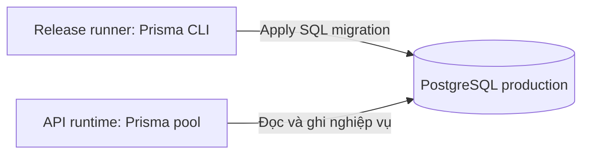

# Kết nối DB với API và release runner

**Dùng khi:** đã có PostgreSQL staging/production và muốn biết URL phải đặt ở đâu.
Bên dưới lấy production làm ví dụ; staging dùng DB staging và Preview của nhánh `develop`.

## 1. Hai chương trình cùng trỏ tới một DB đích



Runner và API có thể dùng credentials khác nhau theo quyền, nhưng phải cùng database/schema đích.
Runtime thường dùng URL pooler nếu được cấp; migration dùng endpoint phù hợp cho schema operations.
Không tự đoán hostname hoặc bỏ yêu cầu TLS của nhà cung cấp.

## 2. URL đặt ở đâu?

| Nơi | Thiết lập | Được dùng khi nào? |
| --- | --- | --- |
| Máy dev | `.env` → DB dev | Dev chạy API/Prisma local |
| Máy release chạy script production | `.env.production` → cả hai URL production | `db:migrate:*:production` đọc file này |
| Job CD cấp secrets trực tiếp | `DATABASE_URL`, `DIRECT_URL` trong environment của job | `npm run db:migrate:apply` |
| Vercel Production | URL runtime production, JWT secret, CORS trong Project Settings | API thuộc nhánh `main`, sau redeploy |
| Host/container production | Environment/secrets của process/container | API khi khởi động |

**Đặt URL trên Vercel không tạo file `.env.production` trên laptop.**
Ngược lại, sửa file env ở laptop không cập nhật secrets của deployment.

Script suffix production yêu cầu file đó; nếu job chỉ có secrets, dùng lệnh generic theo
[CD](../../deployment/cd/index.md#migration-commands). Prisma config tự đọc `.env`,
không tự chọn file production chỉ vì đặt `NODE_ENV`.

## 3. Chuẩn bị file cho máy release

Tại root checkout của release, chỉ tạo file khi chưa tồn tại:

```bash
# Select the project runtime and install the release's locked dependencies.
nvm use
npm ci
# Create production settings without overwriting an existing file.
[ -f .env.production ] || cp .env.example .env.production
```

Điền URL **production** thật vào file bằng editor; không đưa credentials vào command history.
Cả hai URL phải cùng DB; nếu không có proxy/pooler thì có thể dùng cùng một URL.
Máy/job này phải truy cập DB và có quyền tạo/sửa schema. File không được commit hoặc ship vào image.

Nếu chỉ chạy DB commands thì không cần JWT secret; API runtime vẫn cần đầy đủ config.
Đối chiếu [hướng dẫn biến kết nối](../configure-connection.md) và `.env.example`.

## 4. Xác nhận đúng DB trước khi ghi

Trong SQL Editor của connection production trên DBeaver:

```sql
SELECT current_database() AS database_name, current_user AS database_user;
```

Đối chiếu host, database/schema và user với URL đã cấp cho runner và runtime.
Tên file production không tự bảo đảm URL bên trong là production.

**Kết quả:** biết rõ ai kết nối DB nào và ai có quyền apply schema. Chưa có bảng thì
[tạo schema](../migrations/index.md); cập nhật release thì theo
[checklist production](../../deployment/environments/production.md).
