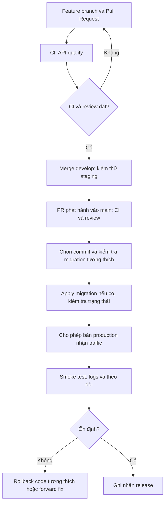

# Triển khai: từ CI đến production

**Dùng khi:** chuẩn bị kiểm tra một PR, phát hành staging/production hoặc đổi nền tảng hosting.
Chạy local và debug nằm ở [Bắt đầu](../getting-started/running/index.md).

## CI và CD khác nhau thế nào?

| Phần | Câu hỏi cần trả lời | Kết quả |
| --- | --- | --- |
| CI — Continuous Integration | Commit có build được, đúng quy tắc và qua test không? | Kết quả kiểm tra gắn với commit; chưa có nghĩa đã deploy |
| CD — Continuous Delivery | Bản nào đã sẵn sàng và được duyệt để phát hành? | Release được kiểm soát; có thể cần người bấm phát hành |
| CD — Continuous Deployment | Bản đạt điều kiện có tự được đưa lên môi trường đích không? | Triển khai tự động sau các điều kiện đã cấu hình |

Với DebtFlow, chọn **CI tự động và phát hành production có kiểm soát**. Vercel vẫn có thể tự build;
việc gán domain production phải theo gate đã thiết lập, không chỉ dựa vào build thành công.

## Hiện có gì trong repository?

| Thành phần | Trạng thái xác minh từ source | Nguồn |
| --- | --- | --- |
| CI cho PR và push | Có workflow `API quality`, job `quality` | `.github/workflows/quality.yml` |
| Kiểm tra code, test và docs | Có trong npm scripts và CI | `package.json` |
| Cho phép Vercel Git deploy | Chỉ `develop`, `main`; các nhánh khác tắt | `vercel.json` |
| Chọn Production Branch, secrets, Deployment Checks | Cấu hình bên ngoài repository; phải kiểm tra trên dashboard | [Hướng dẫn Vercel](./platforms/vercel.md) |
| Job CD nối migration → deploy → smoke test | **Chưa có** trong `.github/workflows/` | [Thiết kế CD](./cd/index.md) |
| Image chạy Node | Có Dockerfile; chưa có workflow publish image/rollout | `Dockerfile` |

Tài liệu phân biệt **đang có** với **cần cấu hình**. Việc đọc trang này không tự bật branch protection,
approval, migration hoặc một pipeline CD trên tài khoản hosting.

Nếu bạn cần deploy ngay, mở **[checklist production: code và DB từng bước](./environments/production.md)**.
Trang con [các tình huống schema](./environments/schema-changes.md) giúp chọn thứ tự cho thêm/đổi/xóa bảng hoặc field.

## Luồng phát hành đề xuất

Đây là quy trình mục tiêu. Vercel Git hiện có thể build ngay khi push, chạy song song với CI.
Cách chặn phát hành và phối hợp schema được giải thích trong [CD](./cd/index.md).

<SectionIndex section="/deployment/" />

## Tham khảo và phần áp dụng

Đã đối chiếu source Vendure tại commit `3ef5fbe70e59ddfd70b4753e9c164ec7934d03eb`:

- [Build & Test](https://github.com/vendure-ecommerce/vendure/blob/3ef5fbe70e59ddfd70b4753e9c164ec7934d03eb/.github/workflows/build_and_test.yml): tách build, unit test, codegen và phát hiện phần ảnh hưởng.
- [Docs CI](https://github.com/vendure-ecommerce/vendure/blob/3ef5fbe70e59ddfd70b4753e9c164ec7934d03eb/.github/workflows/docs_ci.yml): kiểm tra tài liệu có owner riêng.
- [Publish to NPM](https://github.com/vendure-ecommerce/vendure/blob/3ef5fbe70e59ddfd70b4753e9c164ec7934d03eb/.github/workflows/publish_to_npm.yml): tách phát hành khỏi kiểm tra và giới hạn môi trường/quyền publish.

DebtFlow học cách tách trách nhiệm và gate; không sao chép Bun, ma trận nhiều DB/Node hay publish npm
của một thư viện vào API Node 24/PostgreSQL. Phạm vi CI thực tế nằm ở trang tiếp theo.
