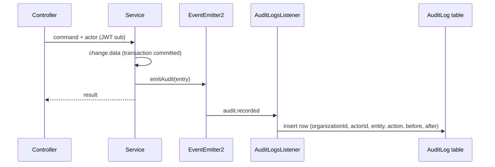

# Audit Log

Every change to debts, payments, parties and members is recorded in the `AuditLog` table: who did it,
to which entity, what the action was, and the record **before** and **after** the change. Entries are
read with `GET /audit-logs` (roles `OWNER`, `ADMIN`; only the caller's organization).

## Recorded actions

| Action                                                  | Entity  |         `before`          |                  `after`                  | Written by                                      |
| ------------------------------------------------------- | ------- | :-----------------------: | :---------------------------------------: | ----------------------------------------------- |
| `debt.created`                                          | Debt    |             -             |                    row                    | `DebtsService.create`                           |
| `debt.updated`                                          | Debt    |            row            |                    row                    | `DebtsService.updateCollection`                 |
| `debt.cancelled`                                        | Debt    |            row            |                    row                    | `DebtsService.cancel`                           |
| `payment.created`                                       | Payment |             -             | voucher + `allocations[{debtId, amount}]` | `PaymentsService.create`, `createAutoAllocated` |
| `payment.reversed`                                      | Payment |   voucher + allocations   |                     -                     | `PaymentsService.remove`                        |
| `party.created` / `party.updated` / `party.deactivated` | Party   |      row / row / row      |                    row                    | `PartiesService`                                |
| `member.updated`                                        | User    | name, phone, status, role |                same fields                | `UsersService.update`                           |
| `member.suspended`                                      | User    |    `membershipStatus`     |            `membershipStatus`             | `UsersService.deactivate`                       |

Snapshots contain the record's own columns only (relations are dropped, money and dates are strings).
Login, token refresh and read operations are not audited.

## Flow



- The event is published **after** the change committed, so a rolled-back transaction leaves no entry.
- The listener catches and logs its own errors: an audit failure never fails the business request.
- The actor is the authenticated user's id (`user.sub`), passed from the controller to the service.

## Querying

```text
GET /audit-logs?sortBy=createdAt&sortOrder=desc
GET /audit-logs?filter[entityType]=Debt&filter[entityId]=<id>
GET /audit-logs?filter[action][startsWith]=payment&filter[createdAt][between]=2026-10-01,2026-10-31
```

Fields: `actorId`, `entityType`, `entityId`, `action`, `createdAt` (see [List Query](./persistence/list-query.md)).
The three named parameters `actorId`, `entityType`, `entityId`, `action` also work as plain filters.

## Auditing a new action

1. Add the action name to `AuditAction` in [`src/common/events/audit-event.ts`](../../src/common/events/audit-event.ts).
2. Inject `EventEmitter2` in the service and call, after the change succeeded:

```ts
emitAudit(this.events, {
  organizationId,
  actorId,
  entityType: 'Product',
  entityId: product.id,
  action: AuditAction.ProductUpdated,
  before: scalarSnapshot(previous),
  after: scalarSnapshot(product),
});
```

3. Pass `user.sub` from the controller as `actorId`.
4. Add the action to the table above.

## Limits to know

- Events are in-process and best effort: if the process stops between the commit and the insert, the entry is lost. If audit must be guaranteed, write the entry in the same transaction instead (the entry type stays the same).
- Entries are not tamper-proof and there is no retention or purge policy yet.
- Retrieval by `before`/`after` content is not supported; filter by entity and action, then read the JSON.
