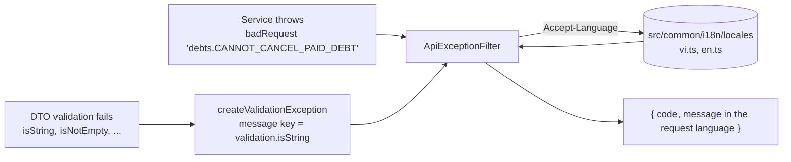

# Localization (EN / VI)

All messages the API produces for the user are localized: the success `message`, error messages, and
the field messages of validation errors. The client chooses the language with the standard header:

```http
Accept-Language: en        # or vi, en-US, vi-VN;q=0.9,en;q=0.8
```

Supported: `vi` and `en`. The **default is `vi`** (header missing or unsupported). Swagger UI shows
an `Accept-Language` dropdown on every endpoint. The BFF in `debtflow-web` already forwards the user's
locale in this header.

```bash
curl -s -X POST localhost:4000/api/auth/login -H 'Content-Type: application/json' \
  -H 'Accept-Language: en' -d '{"email":"a@b.com","password":"wrong-password"}'
# {"success":false,"statusCode":401,"code":"INVALID_CREDENTIALS","message":"Invalid email/phone or password.", ...}
```

## What is translated and what is not

| Part of the response                                   |                 Localized                 |
| ------------------------------------------------------ | :---------------------------------------: |
| `message` (success and error)                          |                    yes                    |
| `errors[].message` of validation errors                |                    yes                    |
| `code`, `errors[].code`, `errors[].field`, enum values | no: stable identifiers, safe to branch on |
| Business data (names, titles, notes)                   |                    no                     |

Frontends should switch on `code`, and display `message`.

## How it works



1. **Services never write user-facing text.** They throw a translation key with the helpers in
   [`src/common/errors/app-errors.ts`](../../src/common/errors/app-errors.ts):

   ```ts
   throw badRequest('debts.CANNOT_CANCEL_PAID_DEBT');
   throw badRequest('query.INVALID_SORT', { field }); // {field} is filled into the text
   ```

   The last segment of the key becomes the machine `code` (`CANNOT_CANCEL_PAID_DEBT`).

2. **Validation messages** come from the constraint that failed. Default class-validator messages are
   replaced by `validation.<constraint>` (for example `validation.isNotEmpty`) and translated with
   `{field}`. To customize, put a key in the decorator and a matching entry in both locales:

   ```ts
   @IsNotEmpty({ message: 'validation.AUTH_EMAIL_REQUIRED', context: { code: 'AUTH_EMAIL_REQUIRED' } })
   ```

3. **Dictionaries** are [`vi.ts`](../../src/common/i18n/locales/vi.ts) and
   [`en.ts`](../../src/common/i18n/locales/en.ts). `en.ts` is typed as the shape of `vi.ts`, so a key
   missing in English is a compile error.

4. Unknown keys fall back to Vietnamese, then to the key itself, so a missing translation is visible
   in the response instead of crashing.

## Adding a message

1. Add the key to `vi.ts` and `en.ts` (group by module: `debts`, `payments`, `items`, `query`, ...).
2. Throw it with `badRequest('group.KEY')`, `unauthorized(...)`, `forbidden(...)`, `notFound(...)` or `conflict(...)`.
3. Never concatenate or hard-code Vietnamese/English text in a service or DTO.

## Response structure

Every JSON response uses the same envelope (see [API Response Format](../guides/api-response-format.md)):
success `{ success, statusCode, code, message, data, meta?, timestamp, path }` and error
`{ success: false, statusCode, code, message, errors?, timestamp, path }`. Binary downloads
(`/exports/debts`) are the only exception.
