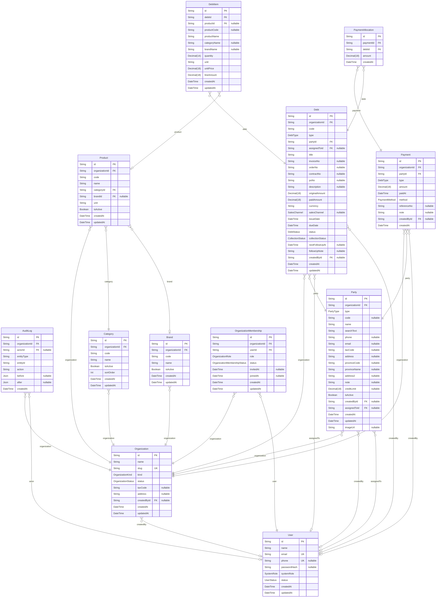

# DebtFlow Database

> Generated by [`prisma-markdown`](https://github.com/samchon/prisma-markdown)

- [default](#default)

## default

### `AuditLog`

Change history of business entities. Written by AuditLogsListener from domain events; read-only through the API.

Properties as follows:

- `id`:
- `organizationId`:
- `actorId`:
- `entityType`:
- `entityId`:
- `action`:
- `before`: Snapshot of the entity before the change.
- `after`: Snapshot of the entity after the change.
- `createdAt`:

### `Category`

Product grouping, unique by code per organization.

Properties as follows:

- `id`:
- `organizationId`:
- `code`:
- `name`:
- `isActive`:
- `sortOrder`:
- `createdAt`:
- `updatedAt`:

### `Brand`

Product brand, unique by code per organization.

Properties as follows:

- `id`:
- `organizationId`:
- `code`:
- `name`:
- `isActive`:
- `createdAt`:
- `updatedAt`:

### `Product`

Sellable item that can be referenced by debt line items.

Properties as follows:

- `id`:
- `organizationId`:
- `code`:
- `name`:
- `categoryId`:
- `brandId`:
- `unit`:
- `isActive`:
- `createdAt`:
- `updatedAt`:

### `DebtItem`

Line item of a debt. Product code, name, category and brand are copied so history survives catalog changes.

Properties as follows:

- `id`:
- `debtId`:
- `productId`: Nullable: the product may be deleted or the line may be free text.
- `productCode`:
- `productName`:
- `categoryName`:
- `brandName`:
- `quantity`:
- `unit`:
- `unitPrice`:
- `lineAmount`:
- `createdAt`:
- `updatedAt`:

### `Debt`

A receivable (customer owes us) or payable (we owe a supplier) document. Remaining = originalAmount - paidAmount.

Properties as follows:

- `id`:
- `organizationId`:
- `code`: Generated per organization as CN-YYYYMM-NNNN.
- `type`:
- `partyId`:
- `assignedToId`: Staff member responsible for collecting this debt.
- `title`:
- `invoiceNo`:
- `orderNo`:
- `contractNo`:
- `poNo`:
- `description`:
- `originalAmount`:
- `paidAmount`: Sum of payment allocations. Maintained by the payment workflow, never edited directly.
- `currency`:
- `salesChannel`:
- `issueDate`:
- `dueDate`: Must not be earlier than issueDate. Drives overdue and aging calculations.
- `status`: Payment lifecycle: OPEN -> PARTIAL -> PAID, or CANCELLED (only when no payment exists).
- `collectionStatus`: Collection workflow stage, independent from the payment status.
- `nextFollowUpAt`:
- `followUpNote`:
- `createdById`:
- `createdAt`:
- `updatedAt`:

### `Party`

Counterparty of a debt: a customer, a supplier, or both.

Properties as follows:

- `id`:
- `organizationId`:
- `type`:
- `code`: Optional business code, unique per organization.
- `name`:
- `searchText`: Normalized text used by the party search (name, code, phone, ...).
- `phone`:
- `email`:
- `taxCode`:
- `address`:
- `provinceCode`:
- `provinceName`:
- `address2`:
- `note`:
- `creditLimit`: Maximum allowed outstanding receivable for this party.
- `isActive`: Soft delete flag. A party with unsettled debts cannot be deactivated.
- `createdById`:
- `assignedToId`:
- `createdAt`:
- `updatedAt`:
- `imageUrl`:

### `Payment`

A voucher (receipt or disbursement) from or to one party. It is split across debts through PaymentAllocation.

Properties as follows:

- `id`:
- `organizationId`:
- `partyId`:
- `type`: RECEIVABLE = money received from a customer, PAYABLE = money paid to a supplier.
- `amount`: Total voucher amount. Equals the sum of its allocations.
- `paidAt`:
- `method`:
- `referenceNo`:
- `note`:
- `createdById`:
- `createdAt`:

### `PaymentAllocation`

The portion of a Payment applied to one Debt. Deleting a payment cascades here and rolls back the debts.

Properties as follows:

- `id`:
- `paymentId`:
- `debtId`:
- `amount`: Amount applied to this debt. Cannot exceed the debt's remaining balance.
- `createdAt`:

### `User`

Login identity. A user is global and gets business access only through an OrganizationMembership.

Properties as follows:

- `id`:
- `name`:
- `email`: Login identifier. Stored lower-cased and unique across all organizations.
- `phone`:
- `passwordHash`: bcrypt hash. Never returned by the API.
- `systemRole`: Platform-level role. Tenant permissions come from OrganizationMembership.role instead.
- `status`: INACTIVE users cannot log in or refresh tokens.
- `createdAt`:
- `updatedAt`:

### `Organization`

Tenant. Every business table (Party, Debt, Payment, Category, Brand, Product, AuditLog) carries organizationId.

Properties as follows:

- `id`:
- `name`:
- `slug`:
- `kind`: PERSONAL (single user) or BUSINESS (team).
- `status`: Only ACTIVE organizations can be used to log in or switch context.
- `taxCode`:
- `address`:
- `createdById`:
- `createdAt`:
- `updatedAt`:

### `OrganizationMembership`

Links a User to an Organization with a role. The JWT carries organizationId, membershipId and role.

Properties as follows:

- `id`:
- `organizationId`:
- `userId`:
- `role`: Authorization role inside this organization (see docs/reference/business-rules.md).
- `status`: Only ACTIVE memberships can authenticate.
- `invitedAt`:
- `joinedAt`:
- `createdAt`:
- `updatedAt`:
