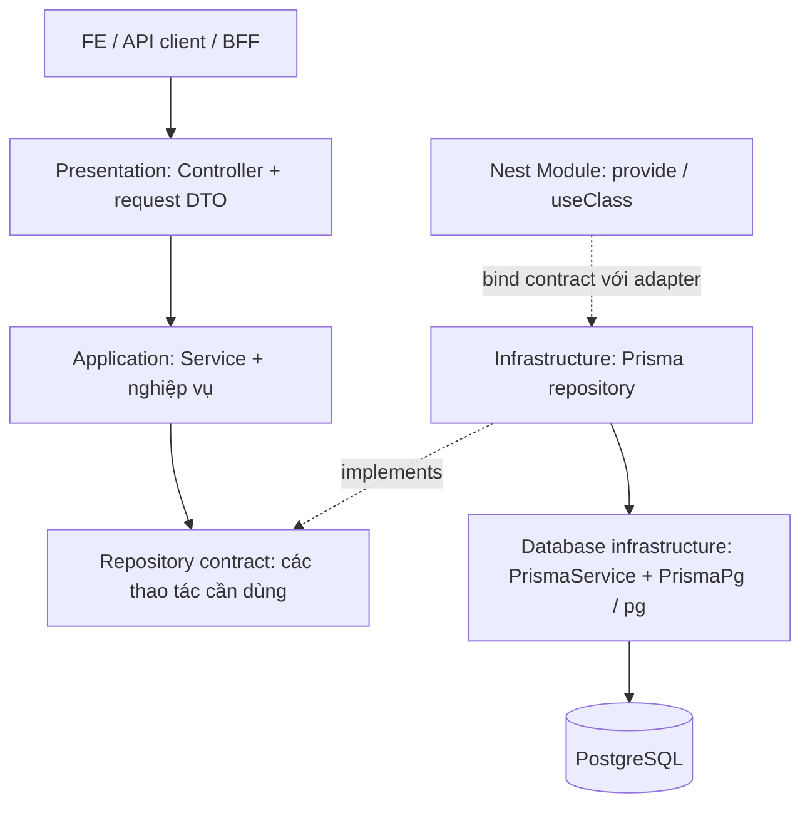

# Kiến trúc backend

DebtFlow là một NestJS REST API, dùng Prisma và PostgreSQL. Code được chia theo **nghiệp vụ** trong
`src/modules/<feature>/`. Mỗi module có một owner; service phối hợp nghiệp vụ, adapter thực thi DB.
Nền tảng hosting PostgreSQL không quyết định cách chia module.

Các API nghiệp vụ dùng ba tầng: **Presentation → Application → Infrastructure**. PostgreSQL là
cơ sở dữ liệu mà ứng dụng kết nối để đọc và ghi dữ liệu. Guards, pipes, interceptor và exception filter là pipeline HTTP dùng
chung; chúng không phải các tầng nghiệp vụ mới.

## Các layer và quan hệ phụ thuộc



Đây là sơ đồ kiến trúc, không phải thứ tự runtime của một request. Mũi tên liền thể hiện nơi dùng hoặc truy cập; mũi tên `implements` là quan hệ triển khai.
Khi chạy, service gọi repository được Nest inject; adapter Prisma là đối tượng thực thi.
Module binding xảy ra khi khởi động ứng dụng, không phải một bước chạy lại cho mỗi request.

| Layer / thành phần | Làm gì? | Không làm gì? |
| --- | --- | --- |
| Controller | Route, role metadata, nhận context/DTO, gọi service, map response, khai báo Swagger | Gọi Prisma hoặc tính nghiệp vụ |
| Request DTO | Validate/transform dữ liệu đầu vào; update DTO có thể kế thừa create DTO khi phù hợp | Query DB hoặc quyết định quyền |
| Service | Điều phối use case, kiểm tra tenant/trạng thái/related IDs, gọi repository, phát audit sau thành công | Import PrismaService, concrete adapter hoặc SQL |
| Repository contract | Khai báo thao tác nghiệp vụ cần, như `list`, `findRecord`, `create` | Expose PrismaClient hoặc nhận SQL bất kỳ |
| Prisma adapter | Query DB, transaction, projection, batch read và aggregate | Đọc request HTTP hoặc tạo response envelope |
| Mapper / rules | Chuyển đổi dữ liệu hoặc tính quy tắc thuần, tái sử dụng trong feature | Tự query DB hoặc phát event |
| Module | Đăng ký controller/providers, bind contract với adapter, import module cần dùng | Chứa logic request |

Đây là modular architecture có ranh giới persistence. Types/DTO và `Prisma.Decimal` có thể được tái
sử dụng theo contract hiện tại; không coi đây là domain hoàn toàn độc lập NestJS/Prisma.
Chỉ thêm layer, lớp cha hoặc submodule khi có trách nhiệm thực tế cần tách.

Với Party hiện tại, **Application do `PartiesService` đảm nhiệm**: `list()` kiểm tra tenant rồi
ủy quyền cho repository; các method ghi kiểm tra nghiệp vụ và phát audit sau thành công.
Không có lớp `UseCase` hay domain entity riêng trong module này. `PartiesRepository` là contract
mà service sử dụng; `PrismaPartiesRepository` mới là implementation thuộc infrastructure.
DTO thuộc đầu vào HTTP, mapper response được controller gọi; không gom chúng vào Application chỉ
để sơ đồ có thêm thành phần.


## Code nằm ở đâu?

```text
src/
  modules/<feature>/   # HTTP, use case và persistence do feature sở hữu
  auth/               # JWT, current user, global guards và role metadata
  common/             # validation, list query, response/error handling, i18n, Swagger
  database/           # Prisma client dùng chung, lifecycle và transaction infrastructure
  config/             # cấu hình môi trường
  generated/          # code sinh tự động; sửa source/generator rồi generate
```

Trong feature, các file thông thường ở gốc khi chỉ có một file cùng trách nhiệm.
Giữ `dto/`, `_test/`, `repositories/`, `infrastructure/` làm ranh giới rõ ràng.
Không tạo sẵn `services/`, `rules/`, `queries/` nếu chưa có nhiều file cần nhóm.
Xem [Project structure](../development/project-structure.md) khi cần quy tắc đặt file chi tiết.

## Những phần dùng chung

- **Auth:** global guards xác thực token và quyền hiện tại. Tenant/actor lấy từ authenticated context.
- **Validation:** DTO và bộ list-query chung kiểm tra input trước khi gọi handler.
- **Response:** controller mapper chọn dữ liệu trả ra; interceptor tạo envelope. Swagger mô tả contract.
- **Persistence:** một Prisma provider cho mỗi app instance; adapter tái sử dụng provider, không tạo client trong từng request.
- **Giao tiếp giữa feature:** dùng public provider contract + module của owner. DTO/type có thể import từ owner theo quy tắc dự án.

`common/`, `database/`, `config/` không phụ thuộc ngược vào feature. Controller/service không gọi
HTTP ngược vào ứng dụng này để tái sử dụng nghiệp vụ.

## Cách đọc tiếp

1. [Xem sơ đồ một request từ FE đến DB](./request-flow.md).
2. [Lần theo ví dụ Party trong source](./party-architecture.md).
3. [Sửa chức năng hoặc thêm module mới](./module-development.md).

Quy tắc bắt buộc: [Backend Rules](../guides/backend-rules/index.md).
Chi tiết transaction và dependency: [Persistence architecture](../development/persistence-architecture.md).
