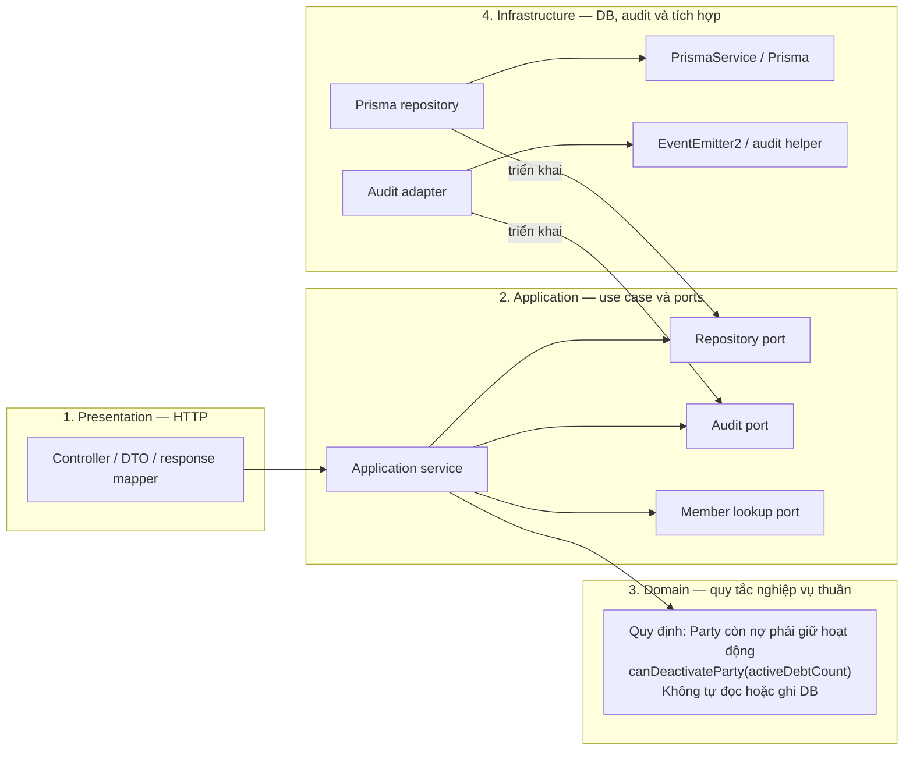
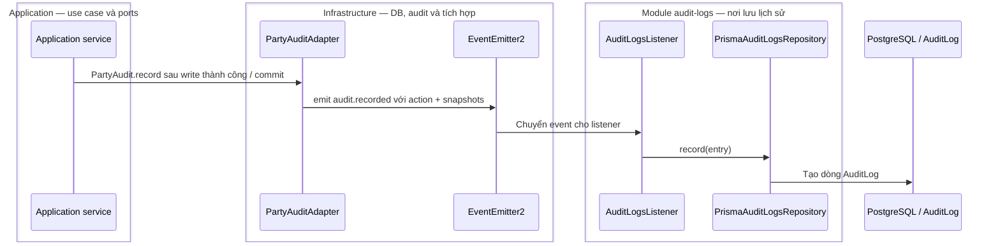

# Clean Architecture của DebtFlow

**DebtFlow là Modular Monolith, áp dụng Clean Architecture từng module.** Các feature chạy trong
cùng ứng dụng NestJS và dùng PostgreSQL. **Party đã có Domain/Application độc lập Nest và Prisma**;
các module còn lại đang giữ ranh giới service → repository → adapter, chưa chuyển hết sang core độc lập.

## Vì sao có hai tên kiến trúc?

| Tên                | Trả lời câu hỏi nào?                      | Trong dự án này                                                                       |
| ------------------ | ----------------------------------------- | ------------------------------------------------------------------------------------- |
| Modular Monolith   | Hệ thống được chia và triển khai thế nào? | Các module nghiệp vụ trong một ứng dụng; chưa tách thành các dịch vụ triển khai riêng |
| Clean Architecture | Code nghiệp vụ phụ thuộc vào đâu?         | Core sở hữu quy tắc và contracts; HTTP, Prisma và event adapters nằm bên ngoài        |

Hai cách tổ chức này dùng cùng nhau. Clean Architecture không yêu cầu microservices, cũng không
bắt buộc mỗi layer phải có một thư mục hoặc một class riêng.

## Các tầng và trách nhiệm

**Core = Domain + Application.** Hai tầng này giữ nghiệp vụ và contracts độc lập Nest/Prisma.
**Adapters = Presentation + Infrastructure.** Chúng chuyển HTTP, DB và cơ chế audit sang contracts của core.
Các tên layer dưới đây được dùng thống nhất trong bảng, sơ đồ và thư mục.
**Các mục 1–4 là bốn tầng; số thứ tự để tra cứu, không phải thứ tự bắt buộc của mọi request.**

| Layer | Chịu trách nhiệm | Code Party hiện có | Không thuộc layer này |
| --- | --- | --- | --- |
| 1. Presentation — HTTP | Route, request DTO/validation, policy quyền của route, Swagger, response mapper | `presentation/parties.controller.ts`, `presentation/dto/`, `presentation/party.mapper.ts` | Query DB, transaction, quyết định nghiệp vụ |
| 2. Application — use case và ports | Điều phối thao tác, tenant/actor context, kiểm tra related IDs qua ports, gọi rule, yêu cầu đọc/ghi và phát audit sau thành công | `application/parties.service.ts`, `party.inputs.ts`, `party-read.types.ts`, `party.ports.ts`, `repositories/parties.repository.ts` | Nest decorators, HTTP DTO, Prisma, concrete adapters |
| 3. Domain — quy tắc nghiệp vụ thuần | Quyết định nghiệp vụ từ dữ liệu được truyền vào; entity/value object chỉ khi có nhu cầu | `domain/party.rules.ts`: `canDeactivateParty` | I/O, DB query, HTTP, event emitter, phụ thuộc Application |
| 4. Infrastructure — DB, audit và tích hợp | Triển khai ports bằng Prisma/SQL hoặc cơ chế giao tiếp thực tế; mapping DB và quản lý transaction | `infrastructure/prisma-parties.repository.ts`, `infrastructure/party-audit.adapter.ts`, `queries/`, `sql/` | Nhận HTTP request, chọn HTTP status, tự thay đổi policy nghiệp vụ |

### 1. Presentation — HTTP, request và response

- **Nhận:** body/query/params và authenticated context do pipeline HTTP cung cấp.
- **Làm:** DTO kiểm tra định dạng, controller gọi service; mapper chọn field public khi trả kết quả.
  Swagger mô tả contract, không tự validate response hoặc thực thi query.
- **Trả:** dữ liệu HTTP để interceptor tạo envelope; lỗi do exception filter chuyển thành status/code/message.
- **Ví dụ:** thêm query parameter cần cập nhật DTO/controller; thêm field response cần cập nhật mapper
  và schema Swagger. Không đặt `prisma.party.findMany()` trong controller.

Guards/pipes/interceptor/filter nằm trong HTTP adapter dùng chung (`src/auth/`, `src/common/`),
không phải các tầng nghiệp vụ mới. Controller không tự lấy tenant từ body để cấp quyền.

### 2. Application — điều phối use case qua ports

- **Nhận:** input TypeScript của use case và tenant/actor context đã xác thực; không nhận `Request`/`Response`.
- **Làm:** phối hợp các thao tác theo đúng thứ tự. Đọc trạng thái qua repository, gọi Domain nếu cần,
  yêu cầu ghi qua transaction-scoped store, rồi gọi audit port sau thay đổi thành công.
- **Trả:** record/read model theo application contract; không trả Prisma client, transaction client hoặc HTTP response.
- **Ví dụ:** vô hiệu hóa Party: đọc Party + đếm nợ trong cùng transaction → gọi `canDeactivateParty`
  → cho ghi nếu hợp lệ → sau commit gọi `PartyAudit.record`.

**Port** là contract mà Application cần, không phải một lần gọi chạy riêng:

| Port Party | Application cần gì? | Implementation được module cấp |
| --- | --- | --- |
| `PartiesRepository` | Đọc/ghi Party, thực hiện nhóm thao tác atomic qua `inTransaction` | `PrismaPartiesRepository` |
| `PartyMembers` | Kiểm tra user còn là member active trong cùng tổ chức | `OrganizationMembersService` do `UsersModule` export |
| `PartyAudit` | Gửi thông tin thay đổi để ghi lịch sử audit | `PartyAuditAdapter` |

Input, read model và ports nằm trong Application vì chúng phục vụ use case. `party-write.mapper.ts`
chuẩn hóa input và giữ ngữ nghĩa PATCH; `presentation/party.mapper.ts` chọn dữ liệu HTTP đầu ra.
Hai mapper khác trách nhiệm, không tạo bản sao cùng một phép chuyển đổi.

### 3. Domain — quy tắc nghiệp vụ

**Domain là phần code mô tả các quy định của nghiệp vụ**, ví dụ: đối tác còn nợ đang hoạt động
thì phải được giữ hoạt động. Đây là nội dung của quy định; Application quyết định cách lấy dữ liệu
và thực hiện thao tác để tuân thủ quy định đó.

Domain có thể chứa điều kiện chuyển trạng thái, công thức tính, entity/value object và các điều kiện
mà dữ liệu nghiệp vụ phải luôn thỏa mãn. **Không bắt buộc có đủ các thành phần này.** Party hiện chỉ có
một rule trong `domain/party.rules.ts`; chưa có entity hoặc value object riêng.

#### 3.1. Hàm `canDeactivateParty` có nên nằm ở Domain không?

**Có, trong Party hiện tại đây là nơi phù hợp.** Hàm diễn đạt quy định:
**“Party chỉ được vô hiệu hóa khi không còn khoản nợ đang hoạt động.”**

```ts
export function canDeactivateParty(activeDebtCount: number): boolean {
  return activeDebtCount === 0;
}
```

Đọc hàm theo nghĩa nghiệp vụ:

- `activeDebtCount`: số khoản nợ đang hoạt động, do repository cung cấp.
- Trả `true`: không còn nợ đang hoạt động, được phép vô hiệu hóa.
- Trả `false`: còn nợ đang hoạt động, phải từ chối thao tác.

**Nó đúng là một hàm kiểm tra.** Điều quyết định vị trí là **nó kiểm tra quy định gì**,
không phải tên bắt đầu bằng `can`/`check`, trả `boolean`, hay chỉ dài một dòng.
Nếu thay HTTP bằng worker hoặc CLI, quy định giữ Party còn nợ vẫn có ý nghĩa.
Đó là lý do dự án giữ hàm này làm rule có tên trong Domain.

**Có bắt buộc phải tách hàm này không? Không.** Viết điều kiện ngay trong application service vẫn có
thể phù hợp với một use case nhỏ, độc lập framework/DB. Clean Architecture không quy định mỗi `if`
phải có một file hay class. Với Party, lựa chọn hiện tại là tách quy định vô hiệu hóa thành rule để
có một nơi đặt tên, đọc và kiểm thử quy định đó. Không tạo thêm Entity, DomainService hoặc
Specification class chỉ để bao lại phép so sánh này. Đây là quyết định tổ chức của dự án, không phải
quy định bắt buộc của Clean Architecture.

#### 3.2. Khi nào hàm này được gọi? Ai đọc và cập nhật DB?

Hàm chỉ được gọi khi thực hiện **vô hiệu hóa Party**, trong
`application/parties.service.ts` → `PartiesService.deactivate`. GET list không gọi hàm này.

| Bước | Nơi thực hiện | Việc thực hiện |
| --- | --- | --- |
| 1 | Application service → Infrastructure repository | Mở transaction; đọc Party và đếm nợ đang hoạt động qua store |
| 2 | Application service → Domain rule | Gọi `canDeactivateParty(activeDebtCount)` với số nợ vừa đọc |
| 3a: trả `false` | Application service | Ném `ApplicationError` với key `parties.CANNOT_DELETE_ACTIVE_DEBTS`; không yêu cầu cập nhật |
| 3b: trả `true` | Application service → Infrastructure repository | Yêu cầu vô hiệu hóa Party trong cùng transaction |
| 4: commit thành công | Application service → audit port | Gửi thông tin thay đổi để ghi audit |

Domain **không tự lấy số nợ, không ghi DB và không chọn HTTP status**. Hàm chỉ quyết định từ số nợ
được truyền vào. Vì dữ liệu DB có thể thay đổi khi nhiều request chạy đồng thời, rule một mình
không bảo đảm an toàn dữ liệu; repository còn phải giữ cơ chế transaction/concurrency hiện có.

#### 3.3. Phân biệt với các hàm kiểm tra khác

| Ví dụ | Vị trí trong dự án | Vì sao? |
| --- | --- | --- |
| Email đúng định dạng, body có field lạ | Presentation DTO/validation pipe | Kiểm tra dữ liệu tại biên HTTP |
| Party còn nợ có được vô hiệu hóa không? | Domain rule | Quy định về trạng thái nghiệp vụ Party |
| Đọc Party, đếm nợ, gọi rule rồi yêu cầu cập nhật | Application service | Thứ tự thực hiện use case |
| Kiểm tra tenant context bắt buộc trước khi gọi repository | Application service | Điều kiện thực hiện use case trong tổ chức đã xác thực |
| Query số nợ theo `organizationId` và Party ID | Infrastructure repository | Cách lấy dữ liệu từ DB |
| Chuẩn hóa chuỗi, loại khoảng trắng | Mapper/helper phù hợp với caller | Phép chuyển đổi dữ liệu; không tự trở thành quy tắc Domain |

Không phân loại bằng việc hàm có `if`, trả `boolean` hay không dùng thư viện. **Hàm thuần là đặc tính
kỹ thuật; quy tắc Domain là trách nhiệm nghiệp vụ.** Một quy tắc Domain cũng có thể validate điều kiện
nghiệp vụ, ví dụ giới hạn tiền hoặc chuyển trạng thái; từ “validation” không chỉ dành riêng cho DTO.

#### 3.4. Tiêu chí quyết định logic nào thuộc Domain

**Đặt ở Domain khi logic định nghĩa điều đúng/sai của nghiệp vụ, công thức hoặc trạng thái hợp lệ
của một khái niệm nghiệp vụ.** Không dùng riêng tiêu chí “hàm thuần” để quyết định vị trí.

Khi phân loại một đoạn logic, trả lời theo thứ tự:

| Câu hỏi | Nếu đúng, đặt ở đâu? | Ví dụ |
| --- | --- | --- |
| Nó kiểm tra cách request được gửi: định dạng, kiểu, field được phép? | Presentation DTO/pipe | Query `page` phải là số nguyên; body không nhận field lạ |
| Nó định nghĩa điều kiện nghiệp vụ hợp lệ, công thức hoặc chuyển trạng thái? | Domain | Party còn nợ phải giữ hoạt động |
| Nó quyết định phải đọc gì, gọi gì trước/sau và xử lý kết quả để hoàn thành một thao tác? | Application | Đếm nợ → gọi rule → yêu cầu vô hiệu hóa → gửi audit sau commit |
| Nó quyết định cách truy cập DB, gửi event hoặc giao tiếp dịch vụ ngoài? | Infrastructure | Prisma `count`, transaction isolation, SQL, event emitter |
| Nó chỉ chuyển đổi dữ liệu hoặc trình bày kết quả? | Mapper/helper tại layer sử dụng | Trim chuỗi, đổi Decimal sang string, chọn field JSON |

**Dấu hiệu của một quy tắc Domain:** mô tả được bằng ngôn ngữ nghiệp vụ mà không cần nhắc HTTP,
Prisma, bảng DB hoặc framework. Nếu đổi API thành worker/CLI, quy định ấy vẫn phải được giữ.
Đây là dấu hiệu để phân tích, không phải phép kiểm tra tự động: Application cũng có logic độc lập HTTP.
Điểm phân biệt tiếp theo là **quy định nghiệp vụ** hay **quy trình thực hiện một use case**.

Các nhóm logic thường thuộc Domain:

| Nhóm | Ví dụ | Domain quyết định gì? |
| --- | --- | --- |
| Điều kiện được phép thực hiện thao tác | Party còn nợ không được vô hiệu hóa — rule hiện có | Được phép hay từ chối theo trạng thái nghiệp vụ |
| Chuyển trạng thái | Minh họa: đơn đã hủy không được chuyển sang đã giao | Trạng thái mới có hợp lệ từ trạng thái hiện tại không |
| Công thức nghiệp vụ | Minh họa: tính phí theo hạng khách hàng và chính sách phí | Giá trị cần tính theo chính sách đã xác định |
| Giới hạn nghiệp vụ | Minh họa: số tiền phân bổ không vượt phần nợ còn lại | Các giá trị có thỏa giới hạn nghiệp vụ không |
| Khái niệm có điều kiện luôn phải đúng | Minh họa: khoảng thời gian có ngày kết thúc không trước ngày bắt đầu | Dữ liệu có tạo thành khái niệm hợp lệ không |

Các dòng ghi **minh họa** giải thích cách phân loại, không tuyên bố dự án đã triển khai các rule đó.
Không tạo sẵn file/class cho các ví dụ này.

**Cùng một field có thể được kiểm tra ở nhiều trách nhiệm khác nhau.** Ví dụ với số tiền:
DTO kiểm tra input có biểu diễn số hợp lệ; Domain kiểm tra số tiền có vượt giới hạn nghiệp vụ;
Application lấy số dư cần dùng; Infrastructure đọc và ghi giá trị trong DB. Không gộp cả bốn việc
vào một hàm `validateAmount` rồi đặt trong Domain.

**Không phải mọi validation đều nằm ở DTO.** Quy tắc “ngày kết thúc không trước ngày bắt đầu” có
thể thuộc Domain nếu đó là điều kiện của khái niệm nghiệp vụ. Ngược lại, “ngày gửi qua HTTP phải
đúng định dạng được API chấp nhận” là request validation. Phân loại theo ý nghĩa, không theo tên field.

Nếu một hàm vừa query DB vừa quyết định nghiệp vụ, tách trách nhiệm: repository lấy dữ liệu,
Domain nhận dữ liệu để quyết định, Application phối hợp hai phần. Việc giữ dữ liệu không thay đổi
giữa kiểm tra và ghi còn cần transaction/concurrency phù hợp; di chuyển `if` vào Domain không tự giải quyết việc đó.

#### 3.5. Các trường hợp dễ nhầm giữa các layer

Một yêu cầu có thể cần code ở nhiều layer. **Phân loại từng trách nhiệm**, không xếp cả tính năng
vào một layer chỉ vì nó có tên “validation”, “permission” hoặc “transaction”.

| Trường hợp | Cách phân chia trong DebtFlow |
| --- | --- |
| Kiểm tra bản ghi tồn tại | Infrastructure truy vấn; Application xử lý không tìm thấy. Bản thân `findById` không phải rule Domain |
| Mã phải duy nhất trong tổ chức | Nếu là quy định nghiệp vụ, mô tả rõ quy định đó; Application phối hợp kiểm tra qua port, Infrastructure/DB giữ unique constraint để chống race. Không tạo hàm Domain chỉ bọc `exists()` |
| Quyền thao tác | JWT/route role gate thuộc HTTP/auth; Application vẫn giữ tenant/ownership checks cần thiết. Một chính sách nghiệp vụ như “người lập không được tự duyệt” có thể thuộc Domain, với danh tính/trạng thái được truyền vào; đây là ví dụ minh họa, không phải policy hiện có của Party |
| Transaction | Application xác định các thao tác phải thành công/thất bại cùng nhau; Infrastructure triển khai transaction, isolation và khóa. Domain không quản lý Prisma transaction |
| Giá trị mặc định | `pageSize` là cấu hình truy vấn; trạng thái khởi tạo là quy tắc Domain nếu nghiệp vụ quy định. Không phân loại mọi default cùng một chỗ |
| Sự kiện | Sự kiện mô tả một sự thật nghiệp vụ có thể là domain event. Cách phát/giao nhận/lưu event thuộc adapters. Audit `audit.recorded` hiện tại không vì có chữ event mà trở thành Domain event |

**Đặt tên theo hành động và điều kiện thực tế.** `canDeactivateParty` nói rõ đang kiểm tra việc
vô hiệu hóa; `validateParty` hoặc `isValid` không cho biết hợp lệ để làm gì. Một Party hợp lệ để
xem danh sách vẫn có thể không được vô hiệu hóa. Xem
[Martin Fowler — Contextual Validation](https://martinfowler.com/bliki/ContextualValidation.html).

**Rule boolean không tự bảo vệ mọi đường ghi.** `canDeactivateParty` hiện là predicate: caller phải
gọi và xử lý kết quả. Party chưa có entity tự chặn mọi thay đổi trạng thái. Vì vậy, thao tác vô hiệu hóa
phải đi qua application use case hiện có; không gọi adapter ghi trực tiếp để bỏ qua rule.
Import checker hỗ trợ giữ dependency, không chứng minh mọi invariant đã được thực thi.

**Cách áp dụng nguồn tham khảo:**
[Microsoft — Domain model validations](https://learn.microsoft.com/en-us/dotnet/architecture/microservices/microservice-ddd-cqrs-patterns/domain-model-layer-validations)
phân biệt validation DTO với bảo vệ điều kiện nghiệp vụ khi trạng thái thay đổi.
[Vladimir Khorikov — Domain services vs Application services](https://enterprisecraftsmanship.com/posts/domain-vs-application-services/)
phân biệt nơi ra quyết định với nơi phối hợp quyết định đó; không phải cứ có `if` là cần Domain service.
Các ví dụ dùng C#/.NET để giải thích nguyên tắc; DebtFlow không sao chép framework, class hoặc pattern
khi chưa có nhu cầu. Giữ Domain Party không I/O là lựa chọn của dự án; không tuyên bố mọi cách triển khai
DDD đều bắt buộc dùng hàm thuần.

#### 3.6. Quy trình quyết định vị trí code khi thêm API

1. Viết rõ quy định bằng ngôn ngữ nghiệp vụ trước, ví dụ “không được vô hiệu hóa đối tác còn nợ”.
2. Nếu cần bảo vệ quy định đó độc lập cách nhận request/lưu dữ liệu, đặt nó ở Domain hiện có.
   Tái sử dụng rule nếu cùng quy định đã có; không chép điều kiện sang controller hoặc adapter.
3. Nếu chỉ là thứ tự thực hiện riêng của use case, giữ ở Application. Nếu chỉ CRUD và không có rule
   riêng, không tạo Domain cho đủ tầng. Một quy định chỉ có một caller vẫn có thể thuộc Domain.
4. Input/read model của use case nằm ở Application; DTO HTTP ở Presentation; payload/query Prisma ở
   Infrastructure. Không chuyển mọi kiểu TypeScript hoặc hàm kiểm tra vào Domain.

Phân biệt trên dựa vào [Entities và Use Cases của Robert C. Martin](https://blog.cleancoder.com/uncle-bob/2012/08/13/the-clean-architecture.html):
quy tắc cốt lõi và điều phối use case có trách nhiệm khác nhau; quy tắc có thể được biểu diễn bằng hàm.
[Transaction Script của Martin Fowler](https://martinfowler.com/eaaCatalog/transactionScript.html)
cho thấy nghiệp vụ cũng có thể tổ chức theo thủ tục. Vì vậy, không suy ra rằng chỉ cần nhiều class/layer
hoặc tách mọi phép kiểm tra là kiến trúc tốt hơn.

### 4. Infrastructure — DB, audit và tích hợp

Infrastructure là **cách thực thi** các yêu cầu I/O của Application. Trong Party có hai adapter riêng:

| Adapter | Làm gì? | Phụ thuộc kỹ thuật |
| --- | --- | --- |
| `PrismaPartiesRepository` | Scope query theo tenant; chọn fields; filter/sort/pagination; truy vấn SQL; transaction; map Prisma payload/Decimal thành application record | `PrismaService`, Prisma, PostgreSQL builders |
| `PartyAuditAdapter` | Nhận `PartyAuditEntry`, tạo scalar snapshot và phát audit event qua helper hiện có | `EventEmitter2`, `emitAudit`, `scalarSnapshot` |

Adapter DB không tự quyết định “còn nợ thì có được xóa hay không”; nó cung cấp count và thực thi
write trong transaction để Application/Domain quyết định đúng trên trạng thái được đọc.
Adapter audit không nhận HTTP request và không chọn HTTP status.

**“Tích hợp” hiện tại gồm audit trong cùng process**, không có nghĩa Party đã dùng Kafka, RabbitMQ,
webhook hoặc microservice. Nếu sau này cần gửi email, storage hoặc API ngoài, tìm owner/port có sẵn
trước; chỉ thêm adapter cho nhu cầu thực tế, không tạo folder rỗng theo sơ đồ.

### Ngoài bốn tầng: Composition — nối các implementation

`parties.module.ts` ở gốc feature là nơi Nest đăng ký controller và dùng factory để cấp repository,
audit adapter, member service vào `PartiesService`. Nó không chứa nghiệp vụ hoặc query.
PostgreSQL và event bus là công cụ/hệ thống mà adapters sử dụng, không phải các layer nghiệp vụ mới.

## Thư mục và tên file

```text
src/modules/parties/
  parties.module.ts                   # Nest composition: binds contracts to adapters
  party.list-query.ts                  # Shared outer-adapter capabilities, schema-checked
  domain/
    party.rules.ts                    # Pure business decisions
  application/
    parties.service.ts                # Coordinates use cases and transactions through ports
    party.inputs.ts                   # Accepted use-case inputs and writable data
    party-read.types.ts               # Repository records and read models returned by use cases
    party.ports.ts                    # Audit and member-lookup contracts
    party-write.mapper.ts             # Normalizes accepted input; preserves PATCH omissions
    repositories/parties.repository.ts
  presentation/
    parties.controller.ts
    party.mapper.ts                   # Maps use-case results to HTTP response fields
    dto/                              # Validation and OpenAPI metadata
  infrastructure/
    prisma-parties.repository.ts
    party-audit.adapter.ts
    queries/                          # Prisma arguments and projections
    sql/                              # PostgreSQL statement builders
  _test/                              # Owned unit, composition and opt-in database tests
```

`application/party-read.types.ts` chứa record và read models trao đổi qua repository/use case. Domain hiện chỉ cần quy tắc vô hiệu hóa Party; không tạo entity hay type nghiệp vụ nếu chưa có nhu cầu. `party.inputs.ts` và `party.ports.ts` có trách nhiệm riêng, không trộn response HTTP vào Domain.
Tên file giữ hậu tố chức năng: `.service.ts`, `.repository.ts`, `.mapper.ts`, `.rules.ts`.

**Cấu hình dùng chung của hai adapter:** `party.list-query.ts` ở gốc feature vì HTTP parser và Prisma
adapter đều dùng allow-list này. Nó kiểm tra metadata Prisma lúc khởi động; đây là cấu hình bên ngoài
core, không phải Domain/Application. Hai layer bên trong bị checker cấm import file này.
Không tạo hai bản allow-list riêng cho HTTP và DB, tránh lệch sort/filter.

## Chiều phụ thuộc của code



Mũi tên thể hiện **phụ thuộc code**, không phải thứ tự chạy. Đặc biệt, **audit adapter dùng event
emitter; repository adapter dùng Prisma**. Không nối chung hai adapter rồi vẽ cả hai gọi DB.
Implementation của member lookup thuộc module Users, được nối vào `PartyMembers` qua Nest composition.

Core không import `PrismaPartiesRepository` hoặc `PartyAuditAdapter`. Khi chạy, service gọi qua port;
module đã cấp implementation tương ứng. Vì vậy runtime có lời gọi Application → Infrastructure,
nhưng chiều import của adapter vẫn hướng về contract do Application sở hữu.

### Audit event là gì trong dự án này?

Đây là thông báo để **ghi lịch sử ai thay đổi gì trong tổ chức nào**. Một event chứa
`organizationId`, `actorId`, `entityType`, `entityId`, `action`, snapshot `before`/`after` khi có.
Party dùng action `party.created`, `party.updated`, `party.deactivated`; tên kênh chung là `audit.recorded`.
Không đưa password, token hoặc password hash vào snapshot.



`PartyAuditAdapter` gọi `emitAudit` trong `src/common/events/audit-event.ts`.
`AuditLogsListener` ở `src/modules/audit-logs/audit-logs.listener.ts` nhận event và gọi repository
của module audit-logs để lưu vào bảng `AuditLog`. GET list không phát event thay đổi.

**Giới hạn hiện tại:** `EventEmitter2.emit` không chờ listener async ghi DB xong.
Listener bắt lỗi ghi audit và log lại; lỗi đó không rollback thay đổi Party đã commit.
Đây là audit best-effort trong process, **chưa có durable queue/outbox hoặc bảo đảm giao nhận**.
Khi yêu cầu audit phải atomic/durable, cần thiết kế transaction/outbox riêng; không được suy từ
sơ đồ rằng Party và AuditLog hiện được commit cùng nhau. Xem [Audit Log](../../development/audit-log.md).

## Request thực tế chạy thế nào?

[Sơ đồ tương tác API chung](./request-flow.md) đặt các layer cạnh nhau, có lời gọi và kết quả trả về.
[Ví dụ Party](./party-architecture.md) chỉ rõ tên file/method và nhánh đọc, ghi, transaction.
Hai sơ đồ này mô tả runtime; sơ đồ ở mục trên mô tả dependency. Không dùng chung một mũi tên
để biểu diễn hai ý nghĩa.

Một API có thể đọc repository trước rồi mới gọi Domain; có thể gọi rule nhiều lần giữa các thao tác.
Không ép mọi request theo một đường `Controller → Service → Domain → DB` cố định.
Auth guard cũng có thể đọc DB trước controller; lỗi dừng luồng và được exception filter xử lý.

## Đặt thay đổi mới ở đâu?

| Bạn đang thêm/sửa gì? | Owner cần sửa | Kiểm tra ranh giới |
| --- | --- | --- |
| Route, body/query validation, Swagger hoặc response JSON | Presentation DTO/controller/mapper | Không query DB; DTO HTTP không đi vào Application |
| Một thao tác nghiệp vụ, điều phối nhiều lần đọc/ghi | Application service và input/port hiện có | Tenant/actor lấy từ context; giữ transaction boundary và phát audit sau thành công |
| Điều kiện nghiệp vụ tính được từ dữ liệu đầu vào | Domain rule | Không I/O, không import Application/Nest/Prisma |
| Query, select, index-dependent sort, Decimal hoặc SQL | Infrastructure repository và helpers của adapter | Scope tenant, lấy type Prisma từ projection; trả đúng application contract |
| Cơ chế gửi audit event | Infrastructure audit adapter | Giữ event shape; không hứa durability khi chưa có cơ chế bảo đảm |
| Đổi implementation/provider | Feature module ở gốc | Đổi binding; không sửa service để tự tạo adapter |

BE/AI bắt đầu từ use case và owner có sẵn, xác định input/output và invariant trước khi tạo file.
Tái sử dụng port/helper phù hợp; không tạo class/folder theo số lượng layer cho đủ hình thức.
Chỉ mở rộng các module khác theo cùng mô hình khi task yêu cầu; Party hiện là module mẫu.

## Vì sao chọn cách này?

| Nhu cầu của DebtFlow                               | Lợi ích phù hợp                                                         |
| -------------------------------------------------- | ----------------------------------------------------------------------- |
| Công nợ, trạng thái, tenant và quyền cần nhất quán | Quy tắc có owner; service phối hợp thao tác, adapter giữ transaction    |
| Nhiều member và AI cùng sửa code                   | Contracts và kiểm tra import giúp chặn việc gọi Prisma từ core          |
| Đã dùng NestJS, Prisma và PostgreSQL               | Giữ công cụ hiện tại; chỉ thay chiều phụ thuộc bên trong module         |
| Muốn kiểm tra nghiệp vụ bằng fake repository       | Core có thể chạy không cần khởi động Nest hoặc database                 |
| Chưa cần triển khai từng feature độc lập           | Một ứng dụng và transaction DB đơn giản hơn việc phối hợp nhiều dịch vụ |

Đổi lại, cần duy trì mapping giữa DB và application contracts. Prisma generated payload types vẫn
được tái sử dụng **trong infrastructure**; core có kiểu độc lập vì không được phụ thuộc ORM.
Điều này không tự động làm query nhanh hơn hay khiến việc đổi database trở nên miễn phí.

## Những gì đã áp dụng và cách giữ đúng kiến trúc

Party có service thuần TypeScript, rules thuần, repository/member/audit ports và Prisma/event adapters.
`check:architecture` kiểm tra mọi file Domain/Application và dependency gián tiếp, bao gồm type imports.
Domain không được phụ thuộc Application; cả hai không được phụ thuộc Presentation, Nest hay Prisma.
HTTP và database adapter không được import implementation của nhau.
Những module khác chưa được xác nhận tuân thủ đầy đủ cùng mức này.

Khi thêm tính năng, đặt code theo trách nhiệm thực tế và giữ transaction, tenant scope cùng response
contract. Không tạo Entity, UseCase hoặc Repository mới nếu chỉ lặp lại trách nhiệm đã có.

Quy tắc gốc: [services và persistence](../../guides/backend-rules/services-persistence.md),
[maintainability](../../guides/backend-rules/maintainability.md).
Cách thực hiện: [viết và bảo trì API](../module-development.md).

### Kết quả rà soát Party theo bốn tầng

Rà soát code ngày **16/11/2026**. Kết quả dưới đây là bằng chứng tại thời điểm kiểm tra,
không thay thế kiểm tra khi có thay đổi mới.

| Tầng | Đã đối chiếu trong code | Kết luận |
| --- | --- | --- |
| 1. Presentation | Controller gọi application service; DTO nhận request; mapper chọn fields; không gọi Prisma | Đúng ranh giới chính |
| 2. Application | Service dùng repository/member/audit ports; không import HTTP DTO, Nest hoặc Prisma; phát audit sau write/commit | Đúng ranh giới chính |
| 3. Domain | `canDeactivateParty` chỉ quyết định từ số nợ; service gọi rule trước khi yêu cầu vô hiệu hóa | Đúng trách nhiệm; predicate vẫn cần caller thực thi |
| 4. Infrastructure | Prisma query/select/SQL/Decimal và transaction nằm trong adapter; trả application contract | Đúng ranh giới persistence; lỗi khoảng ngày/tenant dùng contract trung lập |
| Composition | `parties.module.ts` cấp adapter qua factory/provider bindings | Đúng nơi nối dependency |

**Đã khắc phục lỗi HTTP ở Infrastructure:** query helper báo `ApplicationError('invalid',
'parties.INVALID_DATE_RANGE')`; tenant helper dùng `ApplicationError('forbidden', 'errors.FORBIDDEN')`.
`ApiExceptionFilter` là nơi map sang HTTP 400/403, giữ error key và EN/VI. Helper tenant được dùng
chung; thay đổi này giữ hành vi HTTP cho các module khác, không chuyển kiến trúc của chúng.
Checker chặn Party Infrastructure import trực tiếp shared HTTP error helpers, HTTP/auth/Swagger/filter modules;
Domain/Application tiếp tục được kiểm tra dependency bắc cầu. Các kiểm tra này không thay thế review semantics.

| API Party | Luồng nghiệp vụ và layer cần dùng |
| --- | --- |
| GET list / detail | Presentation nhận input → Application kiểm tra tenant và gọi repository → Infrastructure đọc và map dữ liệu → Presentation map response. Không thêm Domain rule khi không có quyết định nghiệp vụ riêng |
| POST create | Presentation validate DTO → Application chuẩn hóa input, kiểm tra assignee qua port, yêu cầu ghi → Infrastructure lưu → Application gửi audit sau thành công → Presentation map response |
| PATCH update | Application đọc/kiểm tra assignee và cập nhật qua transaction-scoped store; Infrastructure thực thi transaction. Audit sau commit; không tạo Domain rule chỉ để bọc PATCH |
| DELETE deactivate | Application đọc Party/số nợ qua store → Domain quyết định cho phép → Application yêu cầu cập nhật trong cùng transaction → audit sau commit → Presentation map response |

Kiểm chứng cho thay đổi lỗi: **100 test** thuộc Party service/SQL builder và HTTP error filter pass;
**29 test** tenant/organization của các caller dùng chung pass; **15 test** architecture checker pass.
Các spec rule/write mapper/response mapper đã pass ở lượt rà soát trước và code của chúng không thay đổi.
Không chạy PostgreSQL/concurrency hoặc kiểm thử tải trong lượt này; không suy từ test mock rằng mọi
đường ghi DB đều an toàn. Audit vẫn best-effort như mục audit đã mô tả.

## Nguồn tham khảo và quyết định áp dụng

- [Robert C. Martin — The Clean Architecture](https://blog.cleancoder.com/uncle-bob/2012/08/13/the-clean-architecture.html):
  giữ dependency hướng vào trong; domain có thể là dữ liệu và hàm thuần, không bắt buộc Entity class.
- [Sairyss — User module](https://github.com/Sairyss/domain-driven-hexagon/tree/master/src/modules/user):
  tham khảo chia theo feature và tách domain khỏi adapter. Repository này dùng CQRS/Nest trong handler;
  DebtFlow không sao chép bus, decorator và aggregate khi chưa có nhu cầu tương ứng.
- [jonathanPretre — GetTodo use case](https://github.com/jonathanPretre/clean-architecture-nestjs/blob/master/src/usecases/todo/getTodo.usecases.ts):
  use case nhận repository contract; học cách đảo chiều phụ thuộc. DebtFlow dùng application service
  với các method hiện có, không thêm proxy hoặc class bao ngoài chỉ để giống cấu trúc repository mẫu.

Đây là các nguồn nguyên tắc và dự án tham khảo; không coi một mẫu GitHub là tiêu chuẩn thư mục bắt
buộc cho mọi dự án production. Cấu trúc ở trên là lựa chọn của DebtFlow, được kiểm tra bằng import gate.

## Không bắt buộc đi qua đủ mọi layer

Clean Architecture quy định chiều phụ thuộc, không bắt mọi API gọi đủ bốn layer. GET list của Party đi qua Presentation → Application → Infrastructure vì không có quyết định nghiệp vụ cần gọi Domain. Vô hiệu hóa Party gọi Domain để kiểm tra điều kiện còn nợ.

Đặt type theo trách nhiệm: request/response HTTP ở Presentation; input, repository record và read model ở Application; payload Prisma suy ra từ select ở Infrastructure. Chỉ đặt type trong Domain khi nó mô tả khái niệm được quy tắc nghiệp vụ hoặc entity sử dụng; không chuyển mọi type vào Domain chỉ vì nó là TypeScript thuần.
