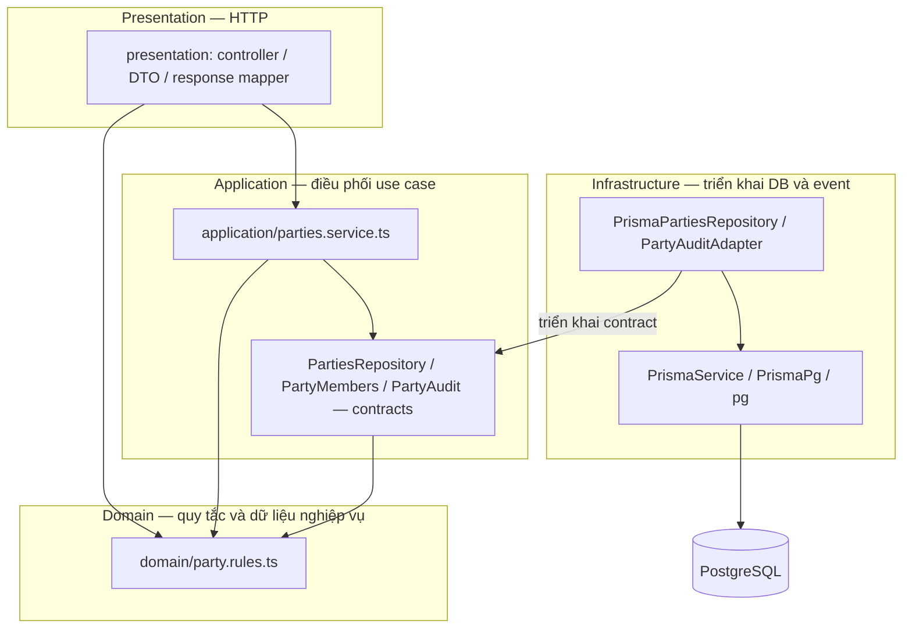
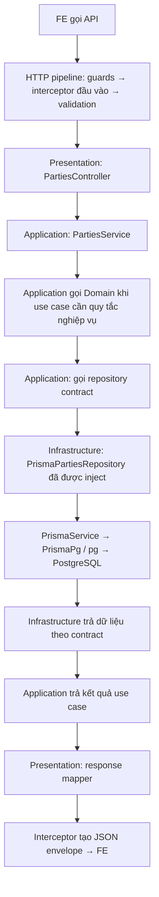

# Clean Architecture của DebtFlow

**DebtFlow là Modular Monolith, áp dụng Clean Architecture từng module.** Các feature chạy trong
cùng ứng dụng NestJS và dùng PostgreSQL. **Party đã có Domain/Application độc lập Nest và Prisma**;
các module còn lại đang giữ ranh giới service → repository → adapter, chưa chuyển hết sang core độc lập.

## Vì sao có hai tên kiến trúc?

| Tên                | Trả lời câu hỏi nào?                      | Trong dự án này                                                                       |
| ------------------ | ----------------------------------------- | ------------------------------------------------------------------------------------- |
| Modular Monolith   | Hệ thống được chia và triển khai thế nào? | Các module nghiệp vụ trong một ứng dụng; chưa tách thành các dịch vụ triển khai riêng |
| Clean Architecture | Code nghiệp vụ phụ thuộc vào đâu?         | Core sở hữu quy tắc và contracts; HTTP, Prisma và event adapters nằm bên ngoài        |

Hai cách tổ chức này dùng cùng nhau. Clean Architecture không yêu cầu microservices, cũng không
bắt buộc mỗi layer phải có một thư mục hoặc một class riêng.

## Các tầng và trách nhiệm

| Layer          | Trách nhiệm                                                                       | Ví dụ Party                                                                               | Không được làm                                         |
| -------------- | --------------------------------------------------------------------------------- | ----------------------------------------------------------------------------------------- | ------------------------------------------------------ |
| Presentation   | Nhận HTTP, validate input, kiểm tra role của route, map response và mô tả Swagger | `presentation/parties.controller.ts`, `presentation/dto/`, `presentation/party.mapper.ts` | Query Prisma hoặc quyết định quy tắc nghiệp vụ         |
| Application    | Điều phối một thao tác: gọi rules, repository, member lookup và audit port        | `application/parties.service.ts`, `application/repositories/parties.repository.ts`        | Import Nest, request DTO, Prisma hoặc concrete adapter |
| Domain         | Quy tắc và dữ liệu nghiệp vụ độc lập HTTP/DB                                      | `domain/party.rules.ts`                                          | Truy cập DB, gọi HTTP hoặc tự thực thi tích hợp event  |
| Infrastructure | Triển khai truy cập DB và tích hợp bên ngoài core                                 | `infrastructure/prisma-parties.repository.ts`, `party-audit.adapter.ts`                   | Quyết định HTTP response hoặc nhận request HTTP        |

`parties.module.ts` là **composition**: nối các implementation vào contracts lúc app khởi động.
Guards, pipes, interceptor và exception filter là pipeline HTTP dùng chung. PostgreSQL là nơi lưu dữ
liệu, không phải một layer code trong feature.

## Thư mục và tên file

```text
src/modules/parties/
  parties.module.ts                   # Nest composition: binds contracts to adapters
  party.list-query.ts                  # Shared outer-adapter capabilities, schema-checked
  domain/
    party.rules.ts                    # Pure business decisions
  application/
    parties.service.ts                # Coordinates use cases and transactions through ports
    party.inputs.ts                   # Accepted use-case inputs and writable data
    party-read.types.ts               # Repository records and read models returned by use cases
    party.ports.ts                    # Audit and member-lookup contracts
    party-write.mapper.ts             # Normalizes accepted input; preserves PATCH omissions
    repositories/parties.repository.ts
  presentation/
    parties.controller.ts
    party.mapper.ts                   # Maps use-case results to HTTP response fields
    dto/                              # Validation and OpenAPI metadata
  infrastructure/
    prisma-parties.repository.ts
    party-audit.adapter.ts
    queries/                          # Prisma arguments and projections
    sql/                              # PostgreSQL statement builders
  _test/                              # Owned unit, composition and opt-in database tests
```

`application/party-read.types.ts` chứa record và read models trao đổi qua repository/use case. Domain hiện chỉ cần quy tắc vô hiệu hóa Party; không tạo entity hay type nghiệp vụ nếu chưa có nhu cầu. `party.inputs.ts` và `party.ports.ts` có trách nhiệm riêng, không trộn response HTTP vào Domain.
Tên file giữ hậu tố chức năng: `.service.ts`, `.repository.ts`, `.mapper.ts`, `.rules.ts`.

**Cấu hình dùng chung của hai adapter:** `party.list-query.ts` ở gốc feature vì HTTP parser và Prisma
adapter đều dùng allow-list này. Nó kiểm tra metadata Prisma lúc khởi động; đây là cấu hình bên ngoài
core, không phải Domain/Application. Hai layer bên trong bị checker cấm import file này.
Không tạo hai bản allow-list riêng cho HTTP và DB, tránh lệch sort/filter.

## Chiều phụ thuộc của code



Mũi tên thể hiện **phụ thuộc code**, không phải thứ tự chạy. Core không import ngược
`PrismaPartiesRepository`. Khi chạy, Nest đã inject adapter này vào `PartiesService` theo binding
trong module. Vì vậy service vẫn gọi được DB qua port mà không biết Prisma.

**Một ví dụ:** Domain quy định Party có nợ đang mở thì không được vô hiệu hóa. Application yêu cầu
repository đọc Party và đếm nợ trong transaction, gọi rule để quyết định, rồi yêu cầu ghi. Infrastructure
thực thi SQL và commit/rollback. Sau commit, Application mới gọi audit port.

## Request thực tế chạy thế nào?



Đây là luồng thành công rút gọn có dùng domain rule, không phải mọi GET phải đi qua Domain.
Kiểm tra có tenant context là tiền điều kiện Application; không phải domain rule của Party. Rule có thể chạy nhiều lần giữa các thao tác repository; chẳng hạn
PATCH cần đọc snapshot trước khi tính dữ liệu cập nhật. Lỗi sẽ kết thúc luồng và được exception filter
chuyển thành response. Auth guard cũng có thể đọc DB trước controller.

- [Luồng HTTP đầy đủ](./request-flow.md): thứ tự guards, validation, handler và xử lý lỗi.
- [Ví dụ Party](./party-architecture.md): sequence diagram với từng file, transaction, sort và response.

## Vì sao chọn cách này?

| Nhu cầu của DebtFlow                               | Lợi ích phù hợp                                                         |
| -------------------------------------------------- | ----------------------------------------------------------------------- |
| Công nợ, trạng thái, tenant và quyền cần nhất quán | Quy tắc có owner; service phối hợp thao tác, adapter giữ transaction    |
| Nhiều member và AI cùng sửa code                   | Contracts và kiểm tra import giúp chặn việc gọi Prisma từ core          |
| Đã dùng NestJS, Prisma và PostgreSQL               | Giữ công cụ hiện tại; chỉ thay chiều phụ thuộc bên trong module         |
| Muốn kiểm tra nghiệp vụ bằng fake repository       | Core có thể chạy không cần khởi động Nest hoặc database                 |
| Chưa cần triển khai từng feature độc lập           | Một ứng dụng và transaction DB đơn giản hơn việc phối hợp nhiều dịch vụ |

Đổi lại, cần duy trì mapping giữa DB và application contracts. Prisma generated payload types vẫn
được tái sử dụng **trong infrastructure**; core có kiểu độc lập vì không được phụ thuộc ORM.
Điều này không tự động làm query nhanh hơn hay khiến việc đổi database trở nên miễn phí.

## Những gì đã áp dụng và cách giữ đúng kiến trúc

Party có service thuần TypeScript, rules thuần, repository/member/audit ports và Prisma/event adapters.
`check:architecture` kiểm tra mọi file Domain/Application và dependency gián tiếp, bao gồm type imports.
Domain không được phụ thuộc Application; cả hai không được phụ thuộc Presentation, Nest hay Prisma.
HTTP và database adapter không được import implementation của nhau.
Những module khác chưa được xác nhận tuân thủ đầy đủ cùng mức này.

Khi thêm tính năng, đặt code theo trách nhiệm thực tế và giữ transaction, tenant scope cùng response
contract. Không tạo Entity, UseCase hoặc Repository mới nếu chỉ lặp lại trách nhiệm đã có.

Quy tắc gốc: [services và persistence](../../guides/backend-rules/services-persistence.md),
[maintainability](../../guides/backend-rules/maintainability.md).
Cách thực hiện: [viết và bảo trì API](../module-development.md).

## Nguồn tham khảo và quyết định áp dụng

- [Robert C. Martin — The Clean Architecture](https://blog.cleancoder.com/uncle-bob/2012/08/13/the-clean-architecture.html):
  giữ dependency hướng vào trong; domain có thể là dữ liệu và hàm thuần, không bắt buộc Entity class.
- [Sairyss — User module](https://github.com/Sairyss/domain-driven-hexagon/tree/master/src/modules/user):
  tham khảo chia theo feature và tách domain khỏi adapter. Repository này dùng CQRS/Nest trong handler;
  DebtFlow không sao chép bus, decorator và aggregate khi chưa có nhu cầu tương ứng.
- [jonathanPretre — GetTodo use case](https://github.com/jonathanPretre/clean-architecture-nestjs/blob/master/src/usecases/todo/getTodo.usecases.ts):
  use case nhận repository contract; học cách đảo chiều phụ thuộc. DebtFlow dùng application service
  với các method hiện có, không thêm proxy hoặc class bao ngoài chỉ để giống cấu trúc repository mẫu.

Đây là các nguồn nguyên tắc và dự án tham khảo; không coi một mẫu GitHub là tiêu chuẩn thư mục bắt
buộc cho mọi dự án production. Cấu trúc ở trên là lựa chọn của DebtFlow, được kiểm tra bằng import gate.

## Không bắt buộc đi qua đủ mọi layer

Clean Architecture quy định chiều phụ thuộc, không bắt mọi API gọi đủ bốn layer. GET list của Party đi qua Presentation → Application → Infrastructure vì không có quyết định nghiệp vụ cần gọi Domain. Vô hiệu hóa Party gọi Domain để kiểm tra điều kiện còn nợ.

Đặt type theo trách nhiệm: request/response HTTP ở Presentation; input, repository record và read model ở Application; payload Prisma suy ra từ select ở Infrastructure. Chỉ đặt type trong Domain khi nó mô tả khái niệm được quy tắc nghiệp vụ hoặc entity sử dụng; không chuyển mọi type vào Domain chỉ vì nó là TypeScript thuần.
