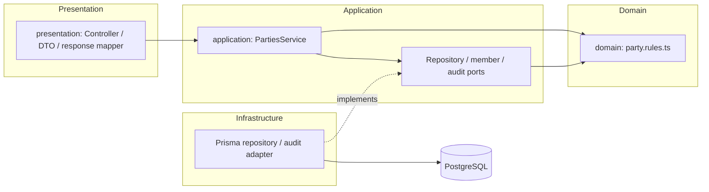
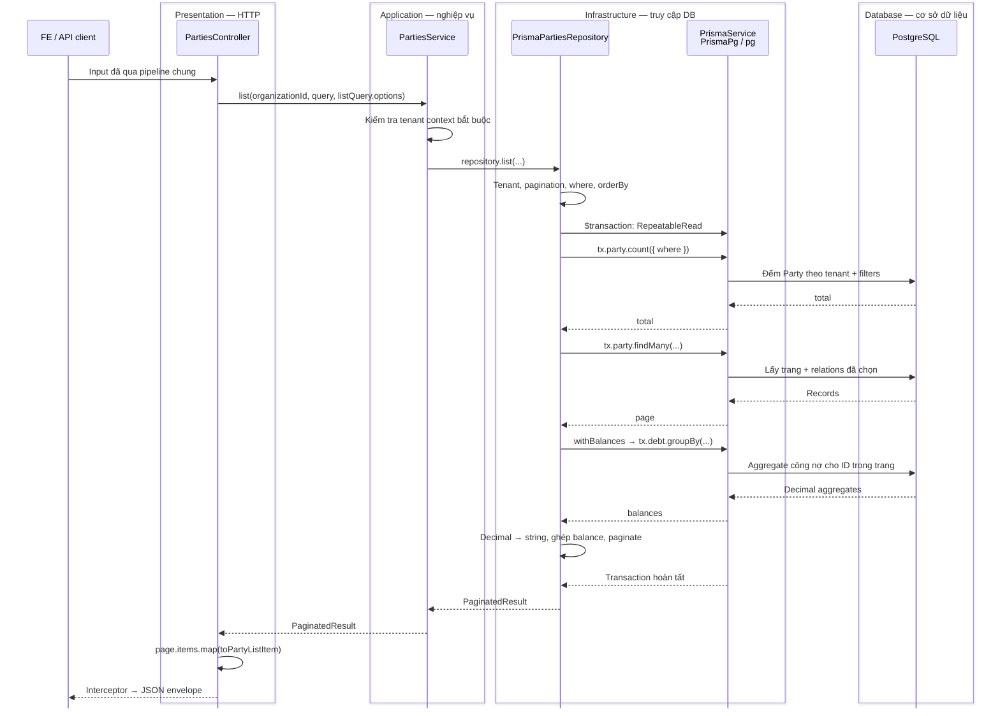
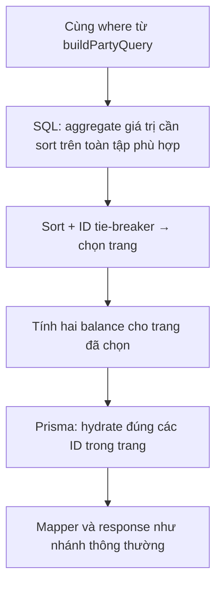
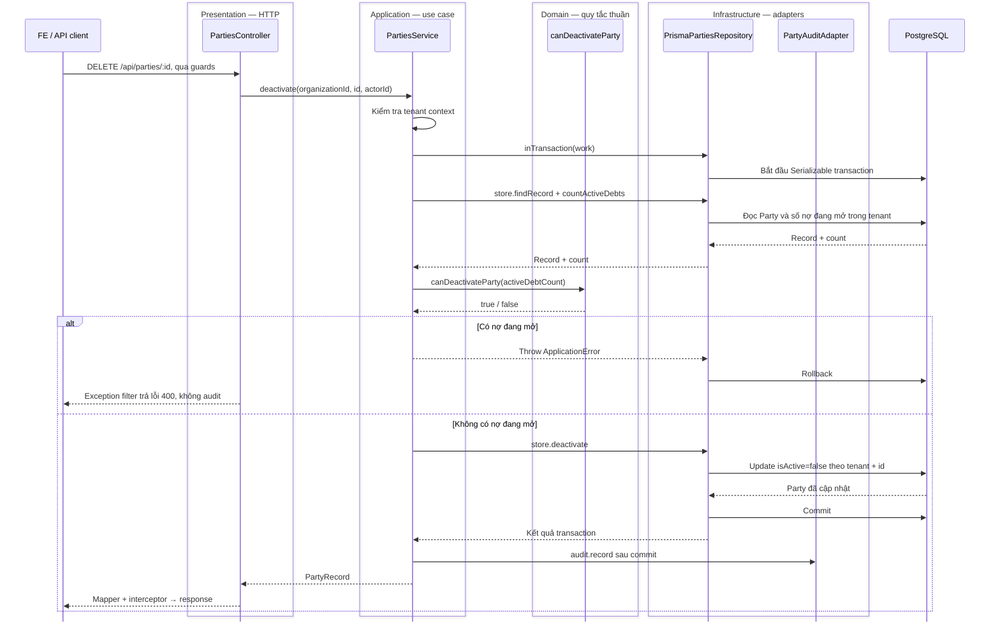

# Ví dụ thực tế: module Party

Đây là ví dụ áp dụng [Clean Architecture của DebtFlow](./clean-architecture.md), không phải một kiến trúc riêng cho Party.
Sau khi xem [request flow](./request-flow.md), mở các file dưới đây trong `src/modules/parties/` để lần theo code.

## Các layer của Party và file tương ứng

Party là module đầu tiên áp dụng **Clean Architecture với core độc lập Nest/Prisma**.
Các module khác vẫn theo ranh giới repository hiện có; chưa được chuyển đồng loạt.

| Layer          | File sở hữu                                                                                                                              | Phụ thuộc được phép                                                    |
| -------------- | ---------------------------------------------------------------------------------------------------------------------------------------- | ---------------------------------------------------------------------- |
| Presentation   | `presentation/parties.controller.ts`, `presentation/dto/`, `presentation/party.mapper.ts`                                                | Application contracts, HTTP validation, Swagger và response mapping    |
| Application    | `application/parties.service.ts`, `application/repositories/parties.repository.ts`                                                       | Domain rules/types và các application port, không Nest/DTO/Prisma      |
| Domain         | `domain/party.rules.ts`                                                                                         | Quy tắc thuần: điều kiện deactivate      |
| Infrastructure | `infrastructure/prisma-parties.repository.ts`, `infrastructure/queries/`, `infrastructure/sql/`, `infrastructure/party-audit.adapter.ts` | Prisma/DB, SQL, EventEmitter2; triển khai contract bên trong           |
| Composition    | `parties.module.ts`                                                                                                                      | Nối repository, audit adapter và member provider bằng factory của Nest |
| Cấu hình adapter | `party.list-query.ts` | Allow-list dùng chung HTTP/Prisma, không được import vào core |

Không tạo thêm lớp `PartyEntity` chỉ để bọc record CRUD. Quy tắc thuần vẫn là domain logic dù không
có class entity. Core không nhận `Request`, DTO class, Prisma delegate, `where` hoặc `orderBy`.
Member lookup và audit đi qua `PartyMembers` / `PartyAudit` trong `application/party.ports.ts`.



Mũi tên trên mô tả **chiều phụ thuộc code**. Runtime vẫn gọi controller → service → implementation
được Nest nối vào port. Dependency từ infrastructure hướng vào contract; core không import adapter.

## Ví dụ: FE lấy danh sách đối tác

```http
GET /api/parties?page=1&pageSize=20&sortBy=createdAt&sortOrder=desc
Authorization: Bearer <access-token>
```

Guard, validation và interceptor dùng chung chạy theo [flow chung](./request-flow.md).
Sơ đồ dưới đây đi sâu vào **nhánh sort `createdAt`, trang có dữ liệu** của request mẫu.

Request GET list đi qua **Presentation**, **Application** và **Infrastructure**. Application kiểm tra tenant context;
GET này không cần gọi domain rule. Ví dụ ghi bên dưới cho thấy đủ bốn layer khi có quy tắc nghiệp vụ.
Các quy tắc của thao tác ghi cũng nằm ở domain, không có truy vấn DB trong domain.
Khung ở đầu sơ đồ nhóm các thành phần cùng tầng; tên tầng nằm ngay trong khung.
PostgreSQL là cơ sở dữ liệu mà ứng dụng kết nối để đọc và ghi dữ liệu.

Khi khởi động, `parties.module.ts` bind `PartiesRepository` với `PrismaPartiesRepository`.
Khi nhận request, service gọi adapter đã được inject; abstract contract không phải một bước chạy riêng.



- Ba lần đọc count / page / balance dùng cùng transaction client `tx`, cùng snapshot.
- `findMany` sort `createdAt DESC, id ASC`, dùng `skip` / `take`; projection có assignee và số nợ.
- Balance chỉ cộng nợ `OPEN` / `PARTIAL` của tenant và các Party trong trang.
- Nếu `skip >= total`, adapter trả trang rỗng ngay sau count, không đọc page / balance.
- Sau mapper, `ApiResponseInterceptor` chuyển `items` thành `data`, thêm `meta.pagination` và các field envelope.
  Nếu có lỗi, request đi qua `ApiExceptionFilter` theo [flow lỗi](./request-flow.md).

**Infrastructure không phải một class chạy thêm sau repository.** `PrismaPartiesRepository`
là adapter nằm trong `infrastructure/`, triển khai abstract contract `PartiesRepository`.
Adapter gọi `PrismaService` dùng chung từ `src/database/`; Prisma dùng adapter `PrismaPg` và driver
`pg` để giao tiếp PostgreSQL. Transaction client `tx` dùng cùng hạ tầng này, không tạo PrismaClient mới.

Sơ đồ mô tả các lời gọi chính, không phải phép đo số SQL statement. Prisma có thể sinh thêm
query cho relation. Count, page và balance được đọc trong cùng snapshot `RepeatableRead`.

## Mở file theo thứ tự này

| Bước | File / hàm                                                    | Vai trò                                                                |
| ---- | ------------------------------------------------------------- | ---------------------------------------------------------------------- |
| 1    | `parties.module.ts`                                           | Bind `PartiesRepository` → `PrismaPartiesRepository` khi app khởi động |
| 2    | `presentation/parties.controller.ts` → `list()`               | Route, context và `@ListQuery(PARTY_LIST_QUERY)`                       |
| 3    | `presentation/dto/query-parties.dto.ts`                       | Validate page và các filter riêng của Party                            |
| 4    | `party.list-query.ts`                                         | Cho phép sort/filter field nào; dùng parser chung                      |
| 5    | `application/parties.service.ts` → `list()`                   | Yêu cầu tenant, gọi repository contract                                |
| 6    | `application/repositories/parties.repository.ts`              | Khai báo method; dùng Go to Implementations để tới adapter             |
| 7    | `infrastructure/prisma-parties.repository.ts` → `list()`      | Nơi gọi DB và mở snapshot transaction                                  |
| 8    | `infrastructure/queries/party.query.ts` → `buildPartyQuery()` | Ghép tenant, filter riêng và dynamic filters                           |
| 9    | `infrastructure/queries/party.select.ts`                      | Projection Prisma và nguồn để suy ra payload types                     |
| 10   | `src/database/prisma.service.ts` (ngoài feature)              | PrismaClient dùng chung + PrismaPg / pg; thực thi query tới PostgreSQL |
| 11   | `presentation/party.mapper.ts` → `toPartyListItem()`          | Chọn field theo public contract; tiền đã là string ở adapter           |
| 12   | `presentation/dto/party-response.dto.ts`                      | Contract response cho Swagger; không tự thực thi mapper                |

`createdAt` là cột DateTime: bộ sort chung dựng `orderBy`, PostgreSQL sắp xếp. Không có hàm sort
ngày riêng của Party. Đổi request sang `sortBy=receivable` sẽ dùng nhánh tính toán dưới đây.

## Nhánh sort công nợ khác ở đâu?



Hai file trong `infrastructure/sql/` dựng SQL, không tự gọi DB:

- `party-balance-page.sql.ts`: aggregate, sort và chọn trang.
- `party-filter.sql.ts`: chuyển phần Prisma predicate được hỗ trợ sang SQL bind tham số.

`party.list-query.ts` là allow-list của request. `infrastructure/queries/` dựng Prisma arguments;
`infrastructure/sql/` dựng SQL PostgreSQL. Service chỉ nhận options sort/filter thuần; adapter mới
biên dịch chúng thành `where`/`orderBy`. Các field lọc vẫn được AND với tenant scope.
`outstandingDocuments` là tên sort cũ, đếm tất cả nợ của tenant, kể cả đã trả/hủy. Balance chỉ tính
nợ OPEN/PARTIAL. Không đổi ý nghĩa hai khái niệm này khi sửa query.

## Ví dụ ghi: cập nhật Party

```text
PATCH route + @Roles
  → UpdatePartyDto (validate HTTP, implements UpdatePartyInput)
  → PartiesService.update
  → repository.inTransaction: Serializable, retry tối đa 2 lần khi P2034
    → store.findRecord: snapshot scalar trong transaction, không tải lịch sử nợ
    → application/party-write.mapper.ts / buildPartyUpdateData: tính lại searchText từ snapshot mới nhất mỗi lần retry
    → store.hasActiveMember: kiểm tra assignee nếu có, dùng cùng transaction
    → store.update: write theo id và organizationId
  → commit thành công → PartyAudit.record → PartyAuditAdapter → emitAudit một lần
  → toPartyResponse → envelope chung
```

Omitted field giữ nguyên; optional null/blank có thể xóa giá trị. PATCH hiện bỏ qua null của name/type.
`application/party-read.types.ts` sở hữu record và kết quả đọc độc lập ORM. `application/party.inputs.ts` định nghĩa
Create/PATCH bằng `Pick`/`Partial` từ dữ liệu đó;
request DTO `implements` input nhưng vẫn giữ decorators validation. Adapter suy ra DB payload từ
Prisma select, chuyển tiền sang string và trả đúng contract. Swagger vẫn kế thừa generated `PartyBase`
qua `PickType`; `presentation/dto/party-response.fields.ts` sở hữu `PARTY_RESPONSE_FIELDS`, dùng chung cho Swagger và HTTP mapper.
Đây là hai contract có chủ đích: schema lưu trữ và dữ liệu ứng dụng; không dùng Prisma type để định
nghĩa core vì như vậy core lại phụ thuộc infrastructure.
Audit hiện là event trong process, không phải outbox bảo đảm lưu bền vững.

## Ví dụ đủ bốn layer: vô hiệu hóa Party



Domain chỉ quyết định `activeDebtCount === 0`; không biết SQL, HTTP hay audit.
Application map kết quả từ chối sang `ApplicationError` với error key hiện có. Adapter thực thi
transaction/retry; các attempt lỗi không phát audit. Sơ đồ thể hiện nhánh thành công/nghiệp vụ,
không liệt kê từng attempt retry hay mọi lỗi kết nối database.

## Khi bạn cần sửa hoặc thêm tính năng

Dùng [bảng chọn đúng layer](../module-development.md#maintain-existing-feature), không copy toàn bộ Party.
Tests nằm trong `_test/`: mapper, service/adapter, SQL builder và PostgreSQL opt-in.
Service không import concrete adapter, DTO, Nest hoặc Prisma, kể cả qua type trung gian.
`check:architecture` kiểm tra dependency bắc cầu của từng layer; Domain cũng không được import Application.
Lỗi nghiệp vụ là `ApplicationError` thuần; `ApiExceptionFilter` map thành HTTP status/code và EN/VI
như trước. Không đưa HTTP exception vào domain để tiện trả response.

## Bảo vệ dữ liệu và giới hạn hiện tại

Update và deactivate dùng `PartyWriteStore`: service không nhận Prisma client và không thể gọi
các thao tác ghi này ngoài transaction qua repository contract. Deactivate đọc Party, đếm nợ đang mở
và vô hiệu hóa trong cùng transaction `Serializable`; tạo nợ cũng dùng `Serializable`. Nếu hai luồng
xung đột, retry sẽ đọc lại trạng thái: có nợ thì từ chối deactivate, Party đã tắt thì từ chối tạo nợ.
Audit chỉ phát sau commit, không phát lại cho các attempt bị rollback. Luồng ghi mới phải giữ cơ chế
này; ghi trực tiếp bằng SQL/import riêng không tự được bảo vệ bởi service.

Detail lọc `organizationId` ở cả Party lẫn relation debts. Các test opt-in trong
`_test/party-writes.postgres.spec.ts` dùng hai Prisma client trên PostgreSQL riêng với dữ liệu giả,
kiểm tra hai thứ tự tạo nợ/deactivate, hai PATCH đồng thời và liên kết nợ sai tenant.

Các giới hạn còn lại:

| Điểm                                  | Tác động / hướng xử lý                                                       |
| ------------------------------------- | ---------------------------------------------------------------------------- |
| Detail trả toàn bộ debts              | Lịch sử lớn chưa được phân trang; thay đổi cần quyết định API riêng          |
| SQL là raw template                   | Bind tham số không kiểm tra tên cột khi compile; cần test SQL liên quan      |
| Detail debts chưa có allow-list riêng | Giữ contract hiện tại; khi thêm cột Debt phải review dữ liệu relation trả ra |

Các test PostgreSQL là opt-in; test mock không xác nhận được hành vi transaction thực tế.
Architecture checker kiểm tra
một số import/placement, không thay cho review nghiệp vụ hay database tests.

Tiếp theo: [Cách sửa chức năng và thêm module mới](../module-development.md).
