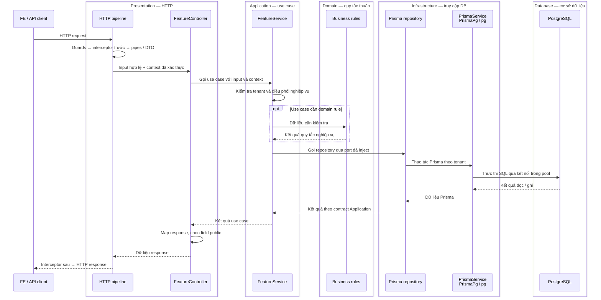
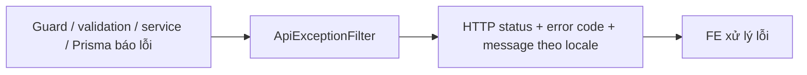

# Một request từ FE đến DB

Trang này giải thích pipeline HTTP chung và đường đi qua các layer của Party đã áp dụng
[Clean Architecture](./clean-architecture.md). Các module khác chưa chuyển hết core độc lập. [Party](./party-architecture.md) ở trang tiếp theo
là ví dụ có tên file và method cụ thể.

## Luồng thành công của một API được bảo vệ

Các thành phần nằm **ngang theo layer**; đọc các tương tác **từ trên xuống**.
Mũi tên liền là lời gọi, nét đứt là kết quả trả về. Tên trong sơ đồ là vai trò chung,
không phải tên class bắt buộc cho mọi module.

Dùng nút mở rộng để xem rõ các layer, zoom và kéo tới tương tác cần theo dõi.
Sơ đồ mô tả **một lần tương tác DB đại diện**, không phải mọi API chỉ chạy một câu SQL.
Use case có thể gọi repository nhiều lần, gọi adapter ngoài hoặc trả kết quả mà không cần DB.

- **Domain:** chỉ gọi khi có rule thuần; GET list Party không cần đi qua bước này.
- **Repository port:** thuộc Application. Nest module bind port với adapter khi app khởi động;
  abstract contract không phải một thành phần thực thi query riêng.
- **Transaction:** Infrastructure chọn theo yêu cầu nhất quán/atomic của use case; không bắt buộc
  mọi API dùng transaction hoặc cùng isolation level. Transaction hoàn tất trước khi trả thành công.
- **Ghi dữ liệu có audit:** service phát audit sau thay đổi thành công/transaction commit qua port
  hoặc cơ chế của module; API chỉ đọc không tự phát audit. Xem [Audit Log](../../development/audit-log.md).
- **Response:** JSON thường qua envelope; response 204/binary tuân theo ngoại lệ trong
  [API response format](../../guides/api-response-format.md).

Đây là flow mục tiêu theo kiến trúc và cách tách lớp đã áp dụng ở Party. Các module chưa chuyển
Clean Architecture vẫn có controller/service/Prisma adapter, nhưng chưa chắc có core độc lập hoặc
folder `domain/`. Đối chiếu [ví dụ Party](./party-architecture.md) để xem tên file, method và query cụ thể.

### Chi tiết bên trong các nhóm

| Nhóm | Thứ tự thực hiện |
| --- | --- |
| Pipeline HTTP | HTTP server xử lý CORS/body parsing, định tuyến `/api` → `JwtAuthGuard` kiểm tra token và trạng thái user/membership/organization → `RolesGuard` kiểm tra quyền route → `ApiResponseInterceptor` đi vào → parameter decorators/pipes resolve context, validate DTO và parse list query. |
| Presentation | Controller nhận input đã resolve/validate, gọi application service. Khi nhận kết quả, response mapper chọn field public và định dạng response. |
| Application + Domain | Service kiểm tra tenant/nghiệp vụ, gọi domain rule khi cần, dùng repository port để yêu cầu đọc/ghi; không gọi Prisma trực tiếp. |
| Infrastructure | Prisma repository triển khai port → `PrismaService` hoặc transaction client → `PrismaPg`/`pg` lấy kết nối từ pool và thực thi SQL trên PostgreSQL; adapter map kết quả về contract Application. |
| Response | Kết quả về service → controller/mapper → phần xử lý kết quả của `ApiResponseInterceptor`: envelope, pagination và localization → HTTP response về FE. |

Đây là đường đi bình thường, không phải mọi request đều chạy tới DB nghiệp vụ. Guard có thể dừng
request sớm; route public bỏ qua phần xác thực theo metadata. `RolesGuard` chỉ yêu cầu role cụ thể
khi route/class có khai báo. Preflight CORS có thể được HTTP middleware xử lý trước handler.

Interceptor có hai thời điểm: đi vào trước pipes/handler và xử lý kết quả sau handler. Không hiểu
nó là một hàm chỉ chạy sau service. Parameter decorator và pipe phối hợp khi Nest resolve tham số;
không dựa vào thứ tự trái/phải của từng tham số controller để điều phối nghiệp vụ.

## Mở file nào để theo dõi?

| Bước                | File                                                                       | Điều cần tìm                                                                   |
| ------------------- | -------------------------------------------------------------------------- | ------------------------------------------------------------------------------ |
| App khởi động       | `src/main.ts`, `src/app.module.ts`                                         | App và các module/providers được đăng ký                                       |
| HTTP setup          | `src/configure-app.ts`                                                     | Prefix, CORS, global validation, Swagger                                       |
| Auth                | `src/auth/auth.module.ts`, `guards/jwt-auth.guard.ts`                      | Global guard, Bearer token, kiểm tra membership hiện tại và gán `request.user` |
| Quyền               | `src/auth/guards/roles.guard.ts`                                           | Metadata từ `@Roles(...)`                                                      |
| Context             | `src/auth/decorators/current-user.decorator.ts`                            | Lấy user đã được guard xác thực                                                |
| Input               | `src/common/query/list-query.pipe.ts`, DTO của feature                     | Validate/transform và từ chối field không được phép                            |
| Dynamic query       | `src/common/query/list-query.decorator.ts` → `list-query-builder.ts`       | Parse filter/sort theo cấu hình resource                                       |
| HTTP handler        | Controller của feature                                                     | Route nào khớp request, service nào được gọi                                   |
| Application         | `src/modules/parties/application/parties.service.ts`                       | Điều phối rule, related-ID checks, repository và audit port                    |
| Domain              | `src/modules/parties/domain/party.rules.ts`       | Quy tắc nghiệp vụ thuần; GET list không cần gọi rule                |
| Contract / DI       | `repositories/*.repository.ts`, feature module                             | Contract không chạy query; module bind adapter khi khởi động                   |
| Nơi gọi DB          | Prisma repository trong `infrastructure/`                                  | `findMany`, `create`, `$queryRaw`, transaction                                 |
| Client / kết nối DB | `src/database/database.module.ts`, `prisma.service.ts`                     | Provider PrismaClient dùng chung; PrismaPg / pg quản lý kết nối tới PostgreSQL |
| Kết quả             | Mapper của feature → `src/common/interceptors/api-response.interceptor.ts` | Fields public, tiền dạng string, envelope                                      |

Auth guard hiện cũng đọc DB để kiểm tra quyền/trạng thái hiện tại. Vì vậy số lần gọi DB của request
không chỉ là các thao tác bên trong repository nghiệp vụ. Cụ thể `JwtAuthGuard` gọi
`PrismaService.organizationMembership.findFirst` trước khi cho request vào controller.

`infrastructure/` là nơi đặt adapter thực thi repository contract, không phải một bước độc lập
ngoài adapter. `DatabaseModule` cấp `PrismaService` cho các adapter; không tạo kết nối mới bằng
`new PrismaClient()` trong mỗi request. Prisma/driver lấy kết nối từ pool khi thực thi query.
`queries/` cung cấp cấu hình/helper được adapter gọi, không tự động là một bước của Nest pipeline.
Audit event chỉ phát ở các operation có ghi dữ liệu; GET list Party không phát audit event.

## Nếu request lỗi

Domain/Application của Party dùng `ApplicationError` thuần; filter map loại lỗi sang HTTP status.
`src/common/filters/api-exception.filter.ts` chuyển lỗi sang error contract chung; không trả
success envelope cho lỗi. Ví dụ: thiếu token → 401, không đủ quyền → 403, DTO sai → 400,
record không tồn tại hoặc không thuộc tenant → kết quả not-found theo contract của operation.
Xem [API response format](../../guides/api-response-format.md) để biết JSON chính xác.

## Phân biệt tài liệu với runtime

- `@ApiEnvelope`, `@ApiListQuery` và response DTO cung cấp metadata Swagger; không thực thi query DB.
- Request DTO + validation pipe kiểm tra input; response mapper chọn dữ liệu thực tế được trả ra.
- Repository contract khai báo method. Để xem code DB, mở adapter được bind trong feature module
  hoặc dùng **Go to Implementations** trong IDE.

Tiếp theo: [Ví dụ một request list Party](./party-architecture.md).
