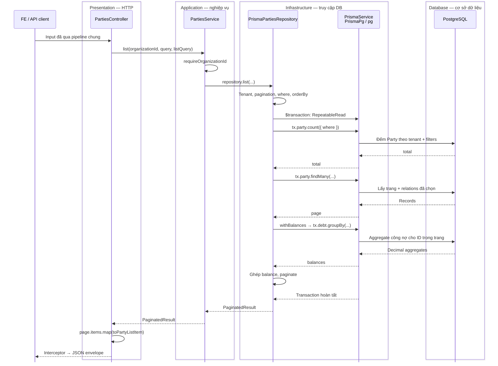
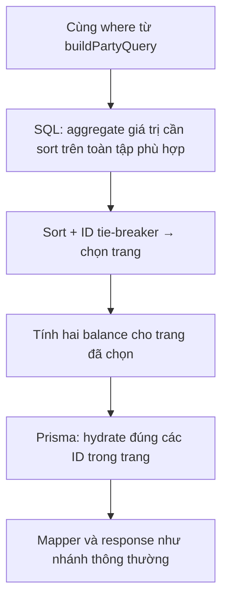

# Ví dụ thực tế: module Party

Đây là ví dụ áp dụng [kiến trúc chung](./architecture.md), không phải một kiến trúc riêng cho Party.
Sau khi xem [request flow](./request-flow.md), mở các file dưới đây trong `src/modules/parties/` để lần theo code.

## Ví dụ: FE lấy danh sách đối tác

```http
GET /api/parties?page=1&pageSize=20&sortBy=createdAt&sortOrder=desc
Authorization: Bearer <access-token>
```

Guard, validation và interceptor dùng chung chạy theo [flow chung](./request-flow.md).
Sơ đồ dưới đây đi sâu vào **nhánh sort `createdAt`, trang có dữ liệu** của request mẫu.

Các API nghiệp vụ đi qua ba tầng: **Presentation** (controller + DTO), **Application**
(service gọi repository contract), **Infrastructure** (Prisma adapter + hạ tầng DB dùng chung).
Khung ở đầu sơ đồ nhóm các thành phần cùng tầng; tên tầng nằm ngay trong khung.
PostgreSQL là cơ sở dữ liệu mà ứng dụng kết nối để đọc và ghi dữ liệu.

Khi khởi động, `parties.module.ts` bind `PartiesRepository` với `PrismaPartiesRepository`.
Khi nhận request, service gọi adapter đã được inject; abstract contract không phải một bước chạy riêng.



- Ba lần đọc count / page / balance dùng cùng transaction client `tx`, cùng snapshot.
- `findMany` sort `createdAt DESC, id ASC`, dùng `skip` / `take`; projection có assignee và số nợ.
- Balance chỉ cộng nợ `OPEN` / `PARTIAL` của tenant và các Party trong trang.
- Nếu `skip >= total`, adapter trả trang rỗng ngay sau count, không đọc page / balance.
- Sau mapper, `ApiResponseInterceptor` chuyển `items` thành `data`, thêm `meta.pagination` và các field envelope.
  Nếu có lỗi, request đi qua `ApiExceptionFilter` theo [flow lỗi](./request-flow.md).

**Infrastructure không phải một class chạy thêm sau repository.** `PrismaPartiesRepository`
là adapter nằm trong `infrastructure/`, triển khai abstract contract `PartiesRepository`.
Adapter gọi `PrismaService` dùng chung từ `src/database/`; Prisma dùng adapter `PrismaPg` và driver
`pg` để giao tiếp PostgreSQL. Transaction client `tx` dùng cùng hạ tầng này, không tạo PrismaClient mới.

Sơ đồ mô tả các lời gọi chính, không phải phép đo số SQL statement. Prisma có thể sinh thêm
query cho relation. Count, page và balance được đọc trong cùng snapshot `RepeatableRead`.

## Mở file theo thứ tự này

| Bước | File / hàm | Vai trò |
| --- | --- | --- |
| 1 | `parties.module.ts` | Bind `PartiesRepository` → `PrismaPartiesRepository` khi app khởi động |
| 2 | `parties.controller.ts` → `list()` | Route, context và `@ListQuery(PARTY_LIST_QUERY)` |
| 3 | `dto/query-parties.dto.ts` | Validate page và các filter riêng của Party |
| 4 | `queries/party.list-query.ts` | Cho phép sort/filter field nào; dùng parser chung |
| 5 | `parties.service.ts` → `list()` | Yêu cầu tenant, gọi repository contract |
| 6 | `repositories/parties.repository.ts` | Khai báo method; dùng Go to Implementations để tới adapter |
| 7 | `infrastructure/prisma-parties.repository.ts` → `list()` | Nơi gọi DB và mở snapshot transaction |
| 8 | `queries/party.query.ts` → `buildPartyQuery()` | Ghép tenant, filter riêng và dynamic filters |
| 9 | `queries/party.select.ts` | Projection Prisma và nguồn để suy ra payload types |
| 10 | `src/database/prisma.service.ts` (ngoài feature) | PrismaClient dùng chung + PrismaPg / pg; thực thi query tới PostgreSQL |
| 11 | `party.mapper.ts` → `toPartyListItem()` | Dữ liệu public thực tế và serialize tiền |
| 12 | `dto/party-response.dto.ts` | Contract response cho Swagger; không tự thực thi mapper |

`createdAt` là cột DateTime: bộ sort chung dựng `orderBy`, PostgreSQL sắp xếp. Không có hàm sort
ngày riêng của Party. Đổi request sang `sortBy=receivable` sẽ dùng nhánh tính toán dưới đây.

## Nhánh sort công nợ khác ở đâu?



Hai file trong `infrastructure/sql/` dựng SQL, không tự gọi DB:

- `party-balance-page.sql.ts`: aggregate, sort và chọn trang.
- `party-filter.sql.ts`: chuyển phần Prisma predicate được hỗ trợ sang SQL bind tham số.

`queries/` chứa định nghĩa dùng chung; `infrastructure/sql/` là triển khai PostgreSQL riêng.
`outstandingDocuments` là tên sort cũ, đếm tất cả nợ của tenant, kể cả đã trả/hủy. Balance chỉ tính
nợ OPEN/PARTIAL. Không đổi ý nghĩa hai khái niệm này khi sửa query.

## Ví dụ ghi: cập nhật Party

```text
PATCH route + @Roles
  → UpdatePartyDto (kế thừa CreatePartyDto)
  → PartiesService.update
  → repository.inTransaction: Serializable, retry tối đa 2 lần khi P2034
    → store.findRecord: snapshot scalar trong transaction, không tải lịch sử nợ
    → buildPartyUpdateData: tính lại searchText từ snapshot mới nhất mỗi lần retry
    → store.hasActiveMember: kiểm tra assignee nếu có, dùng cùng transaction
    → store.update: write theo id và organizationId
  → commit thành công → emitAudit một lần
  → toPartyResponse → envelope chung
```

Omitted field giữ nguyên; optional null/blank có thể xóa giá trị. PATCH hiện bỏ qua null của name/type.
`party.types.ts` dùng Prisma payload/Pick để tái sử dụng kiểu; DTO class giữ runtime metadata.
Audit hiện là event trong process, không phải outbox bảo đảm lưu bền vững.

## Khi bạn cần sửa hoặc thêm tính năng

Dùng [bảng chọn đúng layer](./module-development.md#maintain-existing-feature), không copy toàn bộ Party.
Tests nằm trong `_test/`: mapper, service/adapter, SQL builder và PostgreSQL opt-in.
Service không import concrete adapter; DTO/mapper có thể dùng projection chung mà không import infrastructure.

## Bảo vệ dữ liệu và giới hạn hiện tại

Update và deactivate dùng `PartyWriteStore`: service không nhận Prisma client và không thể gọi
các thao tác ghi này ngoài transaction qua repository contract. Deactivate đọc Party, đếm nợ đang mở
và vô hiệu hóa trong cùng transaction `Serializable`; tạo nợ cũng dùng `Serializable`. Nếu hai luồng
xung đột, retry sẽ đọc lại trạng thái: có nợ thì từ chối deactivate, Party đã tắt thì từ chối tạo nợ.
Audit chỉ phát sau commit, không phát lại cho các attempt bị rollback. Luồng ghi mới phải giữ cơ chế
này; ghi trực tiếp bằng SQL/import riêng không tự được bảo vệ bởi service.

Detail lọc `organizationId` ở cả Party lẫn relation debts. Các test opt-in trong
`_test/party-writes.postgres.spec.ts` dùng hai Prisma client trên PostgreSQL riêng với dữ liệu giả,
kiểm tra hai thứ tự tạo nợ/deactivate, hai PATCH đồng thời và liên kết nợ sai tenant.

Các giới hạn còn lại:

| Điểm | Tác động / hướng xử lý |
| --- | --- |
| Detail trả toàn bộ debts | Lịch sử lớn chưa được phân trang; thay đổi cần quyết định API riêng |
| SQL là raw template | Bind tham số không kiểm tra tên cột khi compile; cần test SQL liên quan |
| Response fields suy ra từ projection | Thêm scalar vào projection có thể làm field xuất hiện trong response; phải review public contract |

Test đồng thời đã chạy qua Prisma driver trên PostgreSQL 18.6 tạm; test SQL read-model trước đó
chạy bằng PGlite. Các kết quả này không phải kiểm thử tải production. Architecture checker kiểm tra
một số import/placement, không thay cho review nghiệp vụ hay database tests.

Tiếp theo: [Cách sửa chức năng và thêm module mới](./module-development.md).
