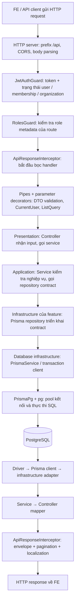
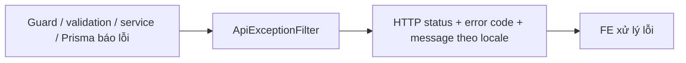

# Một request từ FE đến DB

Trang này giải thích thứ tự xử lý chung của API. [Party](./party-architecture.md) ở trang tiếp theo
là ví dụ có tên file và method cụ thể.

## Luồng thành công của một API được bảo vệ

Đây là đường đi bình thường, không phải mọi request đều chạy tới DB nghiệp vụ. Guard có thể dừng
request sớm; route public bỏ qua phần xác thực theo metadata. `RolesGuard` chỉ yêu cầu role cụ thể
khi route/class có khai báo. Preflight CORS có thể được HTTP middleware xử lý trước handler.

Interceptor có hai thời điểm: đi vào trước pipes/handler và xử lý kết quả sau handler. Không hiểu
nó là một hàm chỉ chạy sau service. Parameter decorator và pipe phối hợp khi Nest resolve tham số;
không dựa vào thứ tự trái/phải của từng tham số controller để điều phối nghiệp vụ.

## Mở file nào để theo dõi?

| Bước | File | Điều cần tìm |
| --- | --- | --- |
| App khởi động | `src/main.ts`, `src/app.module.ts` | App và các module/providers được đăng ký |
| HTTP setup | `src/configure-app.ts` | Prefix, CORS, global validation, Swagger |
| Auth | `src/auth/auth.module.ts`, `guards/jwt-auth.guard.ts` | Global guard, Bearer token, kiểm tra membership hiện tại và gán `request.user` |
| Quyền | `src/auth/guards/roles.guard.ts` | Metadata từ `@Roles(...)` |
| Context | `src/auth/decorators/current-user.decorator.ts` | Lấy user đã được guard xác thực |
| Input | `src/common/query/list-query.pipe.ts`, DTO của feature | Validate/transform và từ chối field không được phép |
| Dynamic query | `src/common/query/list-query.decorator.ts` → `list-query-builder.ts` | Parse filter/sort theo cấu hình resource |
| HTTP handler | Controller của feature | Route nào khớp request, service nào được gọi |
| Nghiệp vụ | Service của feature | Rule/status/related-ID checks |
| Contract / DI | `repositories/*.repository.ts`, feature module | Contract không chạy query; module bind adapter khi khởi động |
| Nơi gọi DB | Prisma repository trong `infrastructure/` | `findMany`, `create`, `$queryRaw`, transaction |
| Client / kết nối DB | `src/database/database.module.ts`, `prisma.service.ts` | Provider PrismaClient dùng chung; PrismaPg / pg quản lý kết nối tới PostgreSQL |
| Kết quả | Mapper của feature → `src/common/interceptors/api-response.interceptor.ts` | Fields public, tiền dạng string, envelope |

Auth guard hiện cũng đọc DB để kiểm tra quyền/trạng thái hiện tại. Vì vậy số lần gọi DB của request
không chỉ là các thao tác bên trong repository nghiệp vụ. Cụ thể `JwtAuthGuard` gọi
`PrismaService.organizationMembership.findFirst` trước khi cho request vào controller.

`infrastructure/` là nơi đặt adapter thực thi repository contract, không phải một bước độc lập
ngoài adapter. `DatabaseModule` cấp `PrismaService` cho các adapter; không tạo kết nối mới bằng
`new PrismaClient()` trong mỗi request. Prisma/driver lấy kết nối từ pool khi thực thi query.
`queries/` cung cấp cấu hình/helper được adapter gọi, không tự động là một bước của Nest pipeline.
Audit event chỉ phát ở các operation có ghi dữ liệu; GET list Party không phát audit event.

## Nếu request lỗi

`src/common/filters/api-exception.filter.ts` chuyển lỗi sang error contract chung; không trả
success envelope cho lỗi. Ví dụ: thiếu token → 401, không đủ quyền → 403, DTO sai → 400,
record không tồn tại hoặc không thuộc tenant → kết quả not-found theo contract của operation.
Xem [API response format](../guides/api-response-format.md) để biết JSON chính xác.

## Phân biệt tài liệu với runtime

- `@ApiEnvelope`, `@ApiListQuery` và response DTO cung cấp metadata Swagger; không thực thi query DB.
- Request DTO + validation pipe kiểm tra input; response mapper chọn dữ liệu thực tế được trả ra.
- Repository contract khai báo method. Để xem code DB, mở adapter được bind trong feature module
  hoặc dùng **Go to Implementations** trong IDE.

Tiếp theo: [Ví dụ một request list Party](./party-architecture.md).
